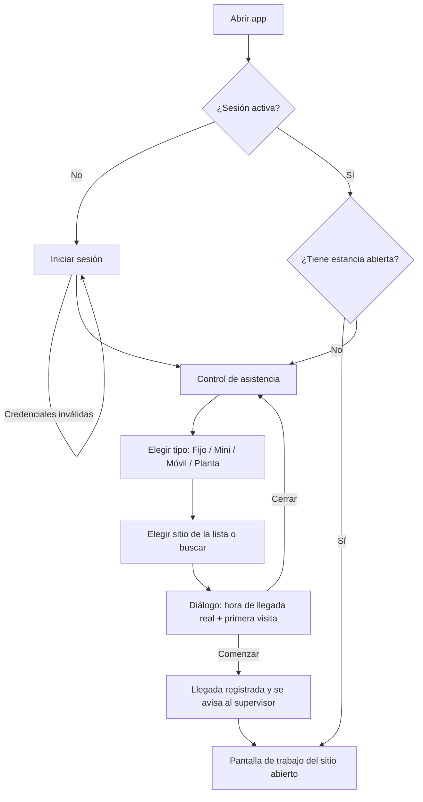
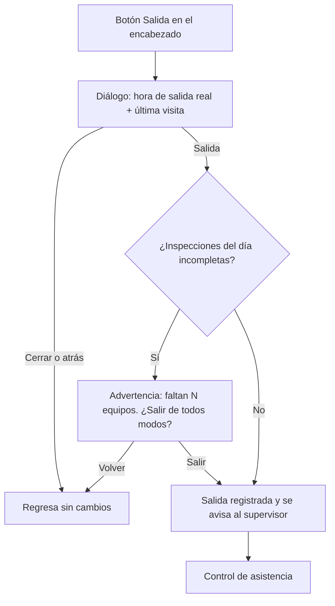
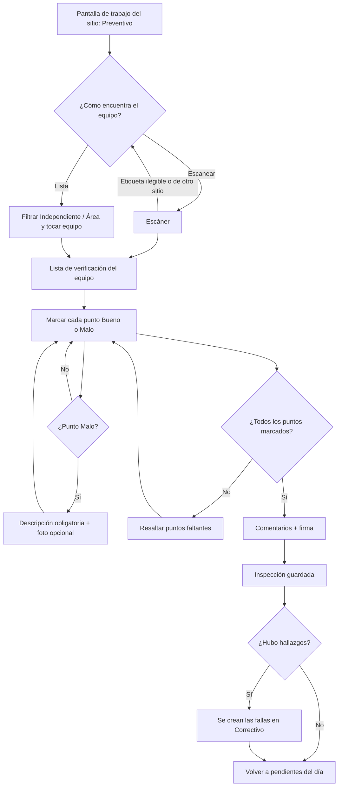
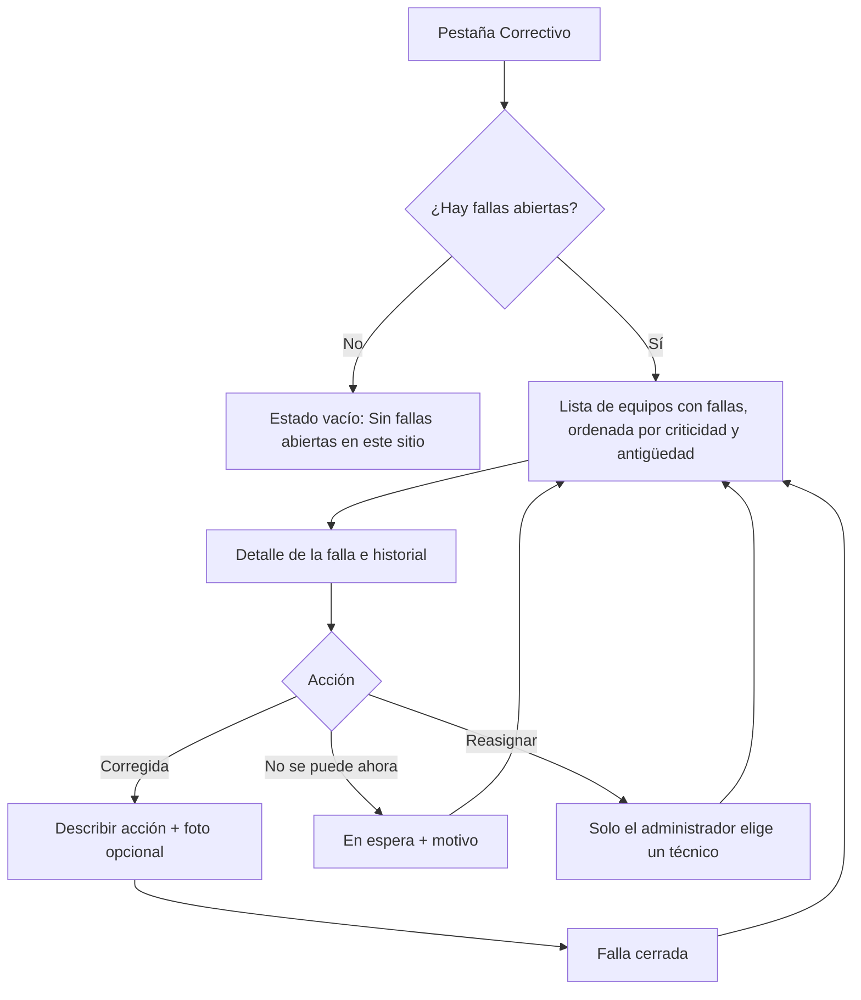
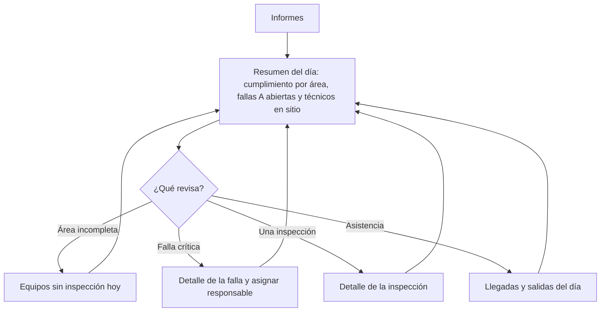
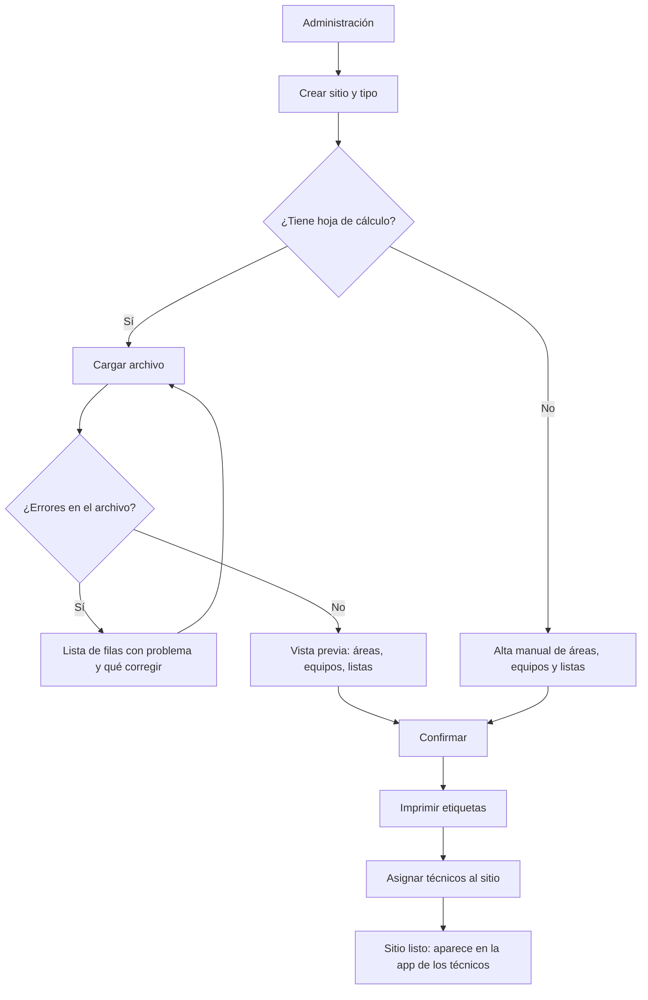

# MaintenanceApp — PRD

**Autor:** Didier Cruz (PO) · borrador asistido por Claude
**Fecha:** 2026-11-16
**Estado:** Draft

> **Documento técnico complementario:** la arquitectura, el modelo de datos (incluido el diseño de base de datos a partir de los formularios VOSOA) y las decisiones de ingeniería van en un TRD aparte. Cuando exista, estará en [TRD.md](./TRD.md).

> **Fuentes:** [overview.md](./overview.md) (reconstruido del prototipo de 2021), las capturas en [design/](./design/) y los tres formularios VOSOA de Planta Tepeagua (Holcim El Salvador). Las metas numéricas son **hipótesis** que se validan en el piloto, porque todavía no hay datos de partida.

## Planteamiento del problema

Los técnicos de mantenimiento inspeccionan a diario decenas de equipos industriales con formularios en papel: solo en una planta de trituración son 31 equipos y unos 384 puntos de revisión por día. Lo que encuentran mal se queda escrito en una hoja que nadie le da seguimiento a tiempo. Los supervisores no saben qué se inspeccionó, qué está fallando ni quién está en cada sitio hasta que alguien les lleva los papeles o los llama.

## Metas y métricas de éxito

### Metas

- **Que ningún hallazgo se pierda:** todo punto de inspección marcado como "Malo" se convierte en una falla con responsable y seguimiento.
- **Visibilidad casi inmediata:** el supervisor ve las inspecciones, las fallas abiertas y la asistencia el mismo día, no cuando llega el papel.
- **Cumplimiento del preventivo:** que las inspecciones diarias realmente se hagan completas, empezando por los equipos de criticidad A.
- **Producto reutilizable:** que sirva a otras empresas con sitios industriales, no solo a Holcim.

### Métricas de éxito

Piloto de referencia: Planta Tepeagua, con 3 áreas, 31 equipos (24 de criticidad A) y unos 384 puntos diarios.

| Métrica | Meta (hipótesis) | Tipo | Cuándo se mide |
|---|---|---|---|
| Días en que las 3 áreas del sitio piloto tienen su inspección diaria completa | ≥ 90 % de los días hábiles | Leading | Semana 4 del piloto |
| Equipos de criticidad A inspeccionados cada día | 100 % (24 de 24) | Leading | Semana 4 del piloto |
| Hallazgos "Malo" que terminan como falla registrada | 100 % (hoy: 0 %, no hay registro) | Leading | Desde el día 1 |
| Tiempo desde que se termina una inspección hasta que el supervisor la ve | < 1 hora (hoy: uno o más días) | Leading | Semana 2 del piloto |
| Tiempo de llenado de un formulario de área | ≤ al tiempo en papel (línea base en la semana 0) | Leading | Semana 2 del piloto |
| Técnicos invitados que usan la app al menos una vez por semana | ≥ 90 % | Leading | Mes 1 |
| Formularios VOSOA en papel en el sitio piloto | 0 | Lagging | Mes 2 |
| Fallas de criticidad A cerradas en 7 días o menos | ≥ 70 % | Lagging | Mes 3 |
| Paros no programados de equipos de criticidad A | −20 % frente al trimestre anterior (necesita el dato del cliente) | Lagging | Mes 6 |
| Empresas usando el producto además de Holcim | ≥ 1 en piloto | Lagging | 6 meses después de v1 |

## Usuarios y Jobs-to-be-Done

### Técnico de mantenimiento de campo

- **Quién:** inspector o mecánico que recorre los equipos de uno o varios sitios: planteles de concreto fijos, mini y móviles, o áreas de una planta. Trabaja de pie, con guantes, con polvo y ruido, muchas veces sin señal.
- **Job:** cuando llego a un sitio a hacer mi ronda, quiero registrar rápido el estado de cada equipo y lo que encontré mal, para que se corrija sin tener que llamar a nadie ni llenar papeles después.
- **Cómo lo resuelve hoy:** imprime el formulario VOSOA, marca Bueno o Malo con lápiz, escribe comentarios, firma y entrega la hoja. Los problemas urgentes los avisa por teléfono o por mensajería [Supuesto].
- **Frecuencia:** diaria. En el sitio piloto son 3 formularios por día.

### Administrador o supervisor de mantenimiento

- **Quién:** jefe de mantenimiento o supervisor responsable de uno o varios sitios. Decide a qué equipo mandar gente y rinde cuentas por la disponibilidad de los equipos.
- **Job:** cuando empieza y termina el turno, quiero saber qué se inspeccionó, qué está mal y quién está dónde, para atender lo crítico antes de que pare la planta.
- **Cómo lo resuelve hoy:** junta los formularios en papel, llama a los técnicos y revisa los hallazgos a mano. No tiene historial consultable [Supuesto].
- **Frecuencia:** varias veces al día.

## Módulos y épicas

Las historias se numeran de forma global (1, 2, 3…) para que el TRD pueda referirse a ellas sin ambigüedad.

| # | Módulo | Propósito | Épicas |
|---|---|---|---|
| 1 | Acceso y asistencia | Saber quién es el técnico y en qué sitio está | 1.A Inicio de sesión · 1.B Llegada y salida del sitio |
| 2 | Mantenimiento preventivo | Hacer la inspección diaria VOSOA de cada equipo, sin papel | 2.A Encontrar el equipo · 2.B Inspección diaria · 2.C Pendientes del día |
| 3 | Mantenimiento correctivo | Convertir cada hallazgo en una falla que se atiende y se cierra | 3.A Reporte de fallas · 3.B Atención y cierre |
| 4 | Informes | Dar visibilidad del cumplimiento, las fallas y la asistencia | 4.A Cumplimiento de inspecciones · 4.B Fallas · 4.C Asistencia |
| 5 | Administración | Configurar la operación y mantener informado al supervisor | 5.A Notificaciones · 5.B Catálogos · 5.C Usuarios y roles |

### Vocabulario del producto

- **Sitio:** un lugar físico que se visita, como un plantel de concreto (fijo, mini o móvil) o una planta (por ejemplo, Planta Tepeagua).
- **Área:** una agrupación de equipos dentro de un sitio, por ejemplo "Trituradora Primaria". Un sitio pequeño puede no tener áreas.
- **Equipo:** un activo que se inspecciona. Tiene etiqueta, número de activo, nombre, foto y criticidad (A, B…). Los equipos que se mueven entre sitios, como un cargador de ruedas o un generador, se llaman **independientes**.
- **Lista de verificación:** los puntos que se revisan en un tipo de equipo (banda, criba, trituradora, alimentador vibratorio, tolva…).
- **Inspección (VOSOA):** el llenado diario de la lista de verificación de **un equipo**. La "hoja de área" del formulario en papel es el conjunto de inspecciones de un área, en un día, por un técnico.
- **Hallazgo:** un punto marcado como "Malo".
- **Falla:** el registro que se le da seguimiento hasta corregir uno o varios hallazgos.

## Requisitos no funcionales globales

| Categoría | Requisito percibido por el usuario | Respaldo |
|---|---|---|
| Sin señal | Puedo hacer toda mi ronda sin conexión y nada se pierde. Lo pendiente se envía solo cuando vuelve la señal, y veo qué falta por enviar. | TRD §Confiabilidad |
| Uso en campo | Puedo usar la app con guantes y a pleno sol: botones grandes, alto contraste y pocos toques por punto. | TRD §Accesibilidad |
| Rapidez | Abrir la lista de un equipo y marcar puntos se siente inmediato, aun con más de 15 puntos. | TRD §Rendimiento |
| Dispositivos | Funciona en teléfonos Android de gama media de hace 3 o 4 años y en iPhone. Android es la prioridad. | TRD §Compatibilidad |
| Integridad | La fecha y la hora de una llegada, salida o inspección son las del momento, y el técnico no las puede editar. | TRD §Seguridad |
| Privacidad | Una empresa nunca ve los datos de otra. Un técnico solo ve los sitios que tiene asignados. | TRD §Seguridad |
| Idioma | Todo el producto está en español. | TRD §Internacionalización |
| Legibilidad | La app respeta el tamaño de letra que el usuario configuró en su teléfono. | TRD §Accesibilidad |

## Riesgos de adopción y de negocio

Salen del pre-mortem: "lanzamos hace 6 meses y fracasó, ¿por qué?". Los riesgos técnicos van en TRD §Riesgos.

| Riesgo | Probabilidad | Impacto | Mitigación |
|---|---|---|---|
| Los técnicos marcan todo "Bueno" sin revisar, y la app lo hace más fácil que el papel | Alta | Alta | No hay botón de "todo bueno" (historia 25). Cada "Malo" exige descripción. El escaneo prueba que el técnico estuvo frente al equipo. El supervisor ve el tiempo que tomó cada inspección. |
| No hay señal en la planta, se pierde trabajo y la gente regresa al papel | Alta | Alta | El trabajo sin conexión es "Must" (historia 19) y se prueba en campo antes del piloto. |
| Configurar 31 equipos y 384 puntos a mano frena el arranque | Media | Alta | Carga desde las hojas de cálculo existentes (historia 54). |
| El proyecto se vuelve a abandonar por falta de un patrocinador en el cliente, como pasó en 2021 | Media | Alta | Comprometer un patrocinador y una fecha de piloto antes de construir (pregunta abierta 1). |
| La seguridad industrial prohíbe teléfonos en las zonas de trituración | Media | Alta | Validarlo antes del piloto (pregunta abierta 3). Si se prohíbe, se llena al salir de la zona, sin conexión. |
| Las etiquetas con código se dañan por polvo o intemperie | Alta | Media | La selección manual del equipo siempre está disponible (historia 13) y las etiquetas son reemplazables (historia 55). |
| El producto queda a la medida de Holcim y no le sirve a nadie más | Media | Alta | Modelo genérico sitio → área → equipo → lista de verificación, y validación con una segunda empresa antes de v2. |
| El supervisor se satura de avisos y los ignora | Media | Media | Aviso inmediato solo para hallazgos en equipos de criticidad A. El resto es configurable (historia 50). |

## Supuestos

| Supuesto | Evidencia | Cómo se valida |
|---|---|---|
| Los técnicos tienen un teléfono inteligente durante el turno | Ninguna | Encuesta a los técnicos del sitio piloto en la semana 0 |
| La inspección diaria VOSOA es representativa del preventivo en otras empresas | 3 formularios de una sola planta | Entrevistas con 2 empresas industriales fuera de Holcim |
| Planteles de concreto y plantas de trituración se pueden describir igual (sitio → área → equipo) | Prototipo de 2021 y formularios VOSOA | Configurar ambos casos en la herramienta de catálogos (5.B) durante el piloto |
| La etiqueta y el número de activo identifican cada equipo sin duplicados | 31 equipos con etiqueta y número únicos en VOSOA | Carga del catálogo completo del sitio piloto |
| Al supervisor le sirve un aviso de llegada y salida en tiempo real | El texto del prototipo: "Se notificará a los administradores" | Entrevista al supervisor del sitio piloto y uso real de los avisos en el mes 1 |
| En las plantas hay señal intermitente, no ausencia total | Ninguna | Prueba de señal por área en la semana 0 |

---

# Módulo 1: Acceso y asistencia

## Resumen

Identifica al técnico y registra en qué sitio está y durante cuánto tiempo. Es la puerta de entrada a todo lo demás: una inspección o una falla siempre queda ligada a una persona, un sitio y una hora. En el prototipo corresponde a la pantalla "Control de Asistencia" y a los diálogos de hora de llegada y de salida (`design/01`–`04`, `09`).

## Alcance

### Incluido (v1)

- Inicio de sesión con usuario y contraseña, con la sesión recordada en el teléfono.
- Elegir el sitio por tipo y por nombre.
- Registrar la llegada y la salida con la hora real.
- Indicar si es la primera o la última visita del día.

### Fuera de alcance (pospuesto)

- Inicio de sesión con la cuenta corporativa de la empresa (SSO), hasta que un cliente lo exija.
- Bloquear la llegada si el técnico no está físicamente en el sitio: tiene implicaciones de privacidad y de precisión dentro de la planta que hay que validar primero.

## Épicas e historias de usuario

### Épica 1.A: Inicio de sesión

**Meta:** que cada acción en la app quede a nombre de una persona identificada.

**Must Have:**
1. Como técnico, quiero iniciar sesión con mis credenciales, para que mis llegadas, inspecciones y fallas queden a mi nombre.
2. Como técnico, quiero que la app recuerde mi sesión en mi teléfono, para no escribir la contraseña cada mañana en la planta.

**Should Have:**
3. Como técnico, quiero recuperar mi acceso si olvido la contraseña, para no depender de un administrador.

**Won't Have (esta versión):**
4. Como técnico, quiero entrar con mi cuenta corporativa. Se pospone hasta que un cliente lo pida como requisito.

### Épica 1.B: Llegada y salida del sitio

**Meta:** registrar con precisión cuándo llega y cuándo sale cada técnico de cada sitio.

**Must Have:**
5. Como técnico, quiero elegir el sitio donde estoy, filtrado por tipo (fijo, mini, móvil, planta), para marcar mi llegada en pocos toques.
6. Como técnico, quiero confirmar mi llegada con la hora real del momento, para que quede registrada sin escribirla. (Hoy el prototipo muestra una hora fija de ejemplo.)
7. Como técnico, quiero marcar mi salida desde cualquier pantalla mientras estoy en un sitio, para cerrar mi estancia ahí.
8. Como técnico, quiero ver siempre en qué sitio tengo una estancia abierta, para no olvidar marcar la salida.

**Should Have:**
9. Como técnico, quiero indicar si es mi primera o mi última visita del día a ese sitio, para que el supervisor entienda mi ruta. (Las casillas existen en el prototipo, pero no hacen nada.)
10. Como técnico, quiero buscar un sitio por nombre, para encontrarlo rápido cuando la empresa tiene decenas.

**Could Have:**
11. Como técnico, quiero que la app me sugiera el sitio más cercano según mi ubicación, para no tener que buscarlo.

**Won't Have (esta versión):**
12. Como supervisor, quiero que la app impida marcar llegada fuera del sitio. Se pospone por privacidad y por la precisión de la ubicación dentro de la planta.

## Flujos de usuario

### Inicio de jornada en un sitio (ruta crítica)

**Entrada:** el técnico abre la app al llegar a un sitio.
**Pasos:**
1. Si no tiene sesión, inicia sesión.
2. Ve "Control de asistencia" con los tipos de sitio en pestañas y los sitios en tarjetas con foto (`design/01`–`03`).
3. Toca el sitio y ve el diálogo "Hora de llegada al Plantel" con la hora actual y la casilla "Primer visita" (`design/04`).
4. Toca "Comenzar". La llegada se registra y la app pasa a la pantalla de trabajo de ese sitio (`design/05`).

**Decisiones:** el tipo de sitio, el sitio, y si es su primera visita del día.
**Estado vacío:** el técnico no tiene sitios asignados. La app muestra "Aún no tienes sitios asignados. Pide a tu administrador que te asigne uno."
**Errores:**
- Si no hay señal, la llegada se guarda en el teléfono y se marca "pendiente de enviar". El aviso al supervisor sale cuando vuelve la conexión.
- Si las credenciales son incorrectas, se muestra un mensaje claro sin indicar cuál dato falló.
**Éxito:** el encabezado muestra el sitio activo y el botón "Salida".

### Salida del sitio

**Entrada:** el botón "Salida" del encabezado (`design/09`).
**Error:** si no hay señal, la salida se guarda y se envía después. El técnico puede marcar llegada en otro sitio aunque haya envíos pendientes.
**Éxito:** el técnico vuelve a "Control de asistencia" sin ninguna estancia abierta.

---

# Módulo 2: Mantenimiento preventivo

## Resumen

Reemplaza el formulario VOSOA en papel. El técnico encuentra el equipo, por la lista o escaneando su etiqueta, recorre la lista de verificación marcando cada punto como Bueno o Malo, documenta los hallazgos y cierra la inspección con comentarios y firma. En el prototipo corresponde a la pestaña "Preventivo" (equipos independientes y de plantel) y a la pantalla de escáner (`design/05`–`07`). Las listas de verificación replican los formularios de Planta Tepeagua: de 4 a 17 puntos por equipo, agrupados por tipo de equipo.

## Alcance

### Incluido (v1)

- Catálogo de equipos del sitio por área y equipos independientes, con foto, etiqueta y criticidad.
- Escaneo de la etiqueta del equipo para abrir su inspección.
- Lista de verificación Bueno/Malo, o "No aplica" en los puntos que lo indican, con descripción obligatoria en cada "Malo".
- Foto del hallazgo y firma del técnico.
- Trabajo sin conexión.
- Lista de pendientes del día.

### Fuera de alcance (pospuesto)

- Planes con frecuencias distintas a la diaria (semanal, mensual, por horas de operación): v1 replica la inspección diaria que ya existe.
- Mediciones con instrumentos conectados (sensores de vibración o temperatura): depende del equipo de cada cliente.

## Épicas e historias de usuario

### Épica 2.A: Encontrar el equipo

**Meta:** que el técnico abra la inspección del equipo correcto en segundos.

**Must Have:**
13. Como técnico, quiero ver los equipos del sitio agrupados por área, con los independientes aparte, mostrando foto, etiqueta y criticidad, para ubicar el que voy a revisar aunque no pueda escanear.

**Should Have:**
14. Como técnico, quiero escanear la etiqueta pegada en el equipo para abrir directamente su inspección, para no confundirme entre equipos parecidos (por ejemplo, 9 bandas en una misma área).

### Épica 2.B: Inspección diaria (VOSOA)

**Meta:** que llenar la inspección en el teléfono sea al menos tan rápido y completo como en papel.

**Must Have:**
15. Como técnico, quiero recorrer la lista de verificación del equipo y marcar cada punto como Bueno o Malo, o "No aplica" en los puntos que lo indican (por ejemplo, "Estado físico de correas (si aplica)"), en el mismo orden que el formulario en papel, para no cambiar mi forma de inspeccionar.
16. Como técnico, quiero que al marcar un punto como Malo la app me pida una descripción breve, para que el hallazgo se entienda sin tener que buscarme.
17. Como técnico, quiero agregar comentarios generales al terminar la inspección de cada equipo, para registrar lo que no cabe en la lista. Cada equipo terminado se envía de inmediato, sin esperar al resto del área.
18. Como técnico, quiero que la fecha, la hora, el sitio, el área y mi nombre se llenen solos, para no escribirlos en cada formulario.
19. Como técnico, quiero hacer la inspección completa aunque no haya señal y que se envíe sola al recuperar la conexión, para no perder trabajo.
20. Como técnico, quiero que la app no me deje cerrar una inspección con puntos sin marcar, o que me diga claramente cuáles faltan, para no entregar formularios incompletos.

**Should Have:**
21. Como técnico, quiero tomar una o más fotos de un punto marcado como Malo, para que el supervisor vea el problema.
22. Como técnico, quiero firmar en la pantalla una vez por ronda y que esa firma se aplique a los equipos que inspecciono en esa área ese día, para cumplir con la firma que pide el formulario actual sin firmar 10 veces.
23. Como técnico, quiero ver el resultado de la inspección anterior del mismo equipo, para notar si un problema se repite.

**Could Have:**
24. Como técnico, quiero anotar un valor en los puntos que lo permitan (por ejemplo, el nivel de aceite), para dar más contexto que solo Bueno o Malo.

**Won't Have (esta versión):**
25. Como técnico, quiero marcar todos los puntos como Bueno con un solo toque. No se incluye porque fomenta inspecciones sin revisar (ver Riesgos).

### Épica 2.C: Pendientes del día

**Meta:** que el técnico sepa qué le falta inspeccionar y que no se salte equipos críticos.

**Must Have:**
26. Como técnico, quiero ver qué equipos del sitio me faltan por inspeccionar hoy y cuáles ya están hechos, para no saltarme ninguno.

**Should Have:**
27. Como técnico, quiero que los equipos de criticidad A aparezcan primero, para atender lo más importante si no me alcanza el turno.

**Won't Have (esta versión):**
28. Como supervisor, quiero programar inspecciones con frecuencias distintas a la diaria. Se pospone: v1 replica la inspección diaria existente.

## Flujos de usuario

### Inspeccionar un equipo (ruta crítica)

**Entrada:** pestaña "Preventivo" con una estancia abierta en el sitio (`design/05`, `06`).
**Pasos:**
1. El técnico ve los equipos filtrados por "Independiente" o por área y, si existe, la lista de pendientes.
2. Escanea la etiqueta del equipo (`design/07`) o lo toca en la lista.
3. Marca cada punto. En cada "Malo" escribe una descripción y opcionalmente toma una foto.
4. Agrega comentarios, firma y guarda.

**Decisiones:** escanear o elegir de la lista, y Bueno o Malo en cada punto.
**Estado vacío:** el sitio no tiene equipos configurados. La app muestra "Este sitio aún no tiene equipos. Tu administrador debe cargarlos."
**Errores:**
- Si la etiqueta escaneada es de otro sitio, la app muestra "Este equipo pertenece a <sitio>".
- Si la cámara no tiene permiso, la app explica cómo activarlo y ofrece elegir el equipo de la lista.
- Si no hay señal, la inspección se guarda en el teléfono como "pendiente de enviar".
- Si la app se cierra a mitad de la inspección, al volver se recupera el borrador.
**Éxito:** el equipo aparece como "hecho" en los pendientes del día y los hallazgos aparecen en Correctivo.

---

# Módulo 3: Mantenimiento correctivo

## Resumen

Da seguimiento a lo que está mal. Cada hallazgo de una inspección, o cada falla que el técnico vea en cualquier momento, se convierte en una falla que se atiende y se cierra con evidencia. En el prototipo corresponde a la pestaña "Correctivo", la lista de equipos con número de fallas y fecha (`design/08`). Hoy no existe ningún formulario de correctivo: este módulo cubre ese vacío.

## Alcance

### Incluido (v1)

- Falla creada automáticamente desde un hallazgo.
- Reporte manual de fallas.
- Lista de equipos con fallas abiertas.
- Detalle de la falla con historial.
- Registro de la acción correctiva y cierre.
- Estado "en espera" con motivo.
- Asignación de responsable.

### Fuera de alcance (pospuesto)

- Enviar fallas u órdenes de trabajo al sistema de gestión de mantenimiento de la empresa (ERP): los números de activo ya existen en los formularios, pero la integración depende de cada cliente.
- Control de inventario de repuestos.

## Épicas e historias de usuario

### Épica 3.A: Reporte de fallas

**Meta:** que ningún problema detectado quede sin registro.

**Must Have:**
29. Como técnico, quiero que cada punto marcado como Malo cree automáticamente una falla para ese equipo, con mi descripción y mis fotos, para que ningún hallazgo se quede en el papel.
30. Como técnico, quiero reportar una falla de cualquier equipo aunque no esté haciendo una inspección, para registrar lo que veo en el momento.
31. Como técnico, quiero ver la lista de equipos con fallas abiertas, con cuántas tiene cada uno y desde cuándo, para decidir qué atender primero.

**Should Have:**
32. Como técnico, quiero que, si el mismo punto del mismo equipo vuelve a salir Malo mientras su falla sigue abierta, el hallazgo se sume a esa falla en lugar de crear otra, para no tener 10 reportes del mismo problema.
33. Como técnico, quiero indicar la urgencia de una falla ("puede esperar", "atender pronto", "equipo detenido"), para que el supervisor priorice.

### Épica 3.B: Atención y cierre

**Meta:** que cada falla tenga un responsable y termine cerrada con evidencia de lo que se hizo.

**Must Have:**
34. Como técnico, quiero abrir el detalle de una falla y ver su historial (quién la reportó, cuándo, fotos, hallazgos relacionados y comentarios), para entender el problema antes de ir al equipo.
35. Como técnico, quiero registrar qué hice para corregir la falla y cerrarla, para que quede constancia y salga de los pendientes.

**Should Have:**
36. Como técnico, quiero dejar una falla "en espera" con un motivo (falta de repuesto, esperar paro de planta), para que se sepa por qué sigue abierta.
37. Como administrador, quiero asignar una falla a un técnico, para que tenga un responsable claro.

**Could Have:**
38. Como técnico, quiero anotar los repuestos que usé al cerrar una falla, para que el supervisor tenga ese dato.

**Won't Have (esta versión):**
39. Como administrador, quiero que las fallas se envíen al sistema de mantenimiento de mi empresa. Se pospone porque depende del sistema de cada cliente.

## Flujos de usuario

### Atender una falla (ruta crítica)

**Entrada:** pestaña "Correctivo", el aviso de una falla asignada, o justo después de guardar una inspección con hallazgos.
**Pasos:**
1. El técnico ve los equipos con fallas abiertas (`design/08`).
2. Toca uno y ve el detalle (hoy ese toque no hace nada en el prototipo).
3. Registra la acción y cierra la falla, o la deja en espera con motivo.

**Estado vacío:** "Sin fallas abiertas en este sitio" junto a un acceso para reportar una falla nueva.
**Errores:**
- Si no hay señal, el cierre se guarda en el teléfono y se envía después.
- Si la falla ya la cerró otra persona, la app lo indica y la quita de la lista.
**Éxito:** la falla desaparece de los pendientes, el contador del equipo baja y el supervisor ve el cierre.

### Reportar una falla fuera de inspección

**Entrada:** botón "Reportar falla" en Correctivo, o desde la ficha de un equipo.
**Pasos:**
1. El técnico elige o escanea el equipo.
2. Describe el problema, indica la urgencia y opcionalmente toma una foto.
3. Envía el reporte.

**Error:** si falta la descripción, la app no deja enviar.
**Éxito:** la falla aparece en la lista. Si el equipo es de criticidad A, se avisa al supervisor.

---

# Módulo 4: Informes

## Resumen

Da al supervisor, y en menor medida al técnico, una vista del cumplimiento de las inspecciones, las fallas abiertas y la asistencia, sin juntar papeles. En el prototipo es la pestaña "Informes", que hoy solo dice "Espérala Pronto!" (`design/10`).

## Alcance

### Incluido (v1)

- Cumplimiento de las inspecciones diarias por sitio y área.
- Consulta de cualquier inspección.
- Fallas abiertas por criticidad y antigüedad.
- Equipos y puntos con más hallazgos.
- Asistencia por técnico y sitio.
- Resumen semanal para el técnico.
- Exportación a hoja de cálculo.

### Fuera de alcance (pospuesto)

- Tableros personalizables: primero hay que validar qué informes se usan de verdad.
- Indicadores avanzados de confiabilidad (tiempo medio entre fallas, disponibilidad): necesitan historial y datos de operación que v1 no captura.

## Épicas e historias de usuario

### Épica 4.A: Cumplimiento de inspecciones

**Meta:** que el supervisor sepa cada día si el preventivo se hizo.

**Must Have:**
40. Como administrador, quiero ver por sitio y por área el porcentaje de inspecciones diarias hechas, por día y por semana, para saber si se está cumpliendo.
41. Como administrador, quiero ver el detalle de cualquier inspección (puntos, hallazgos, fotos, comentarios, quién, cuándo y cuánto tardó), para revisarla sin pedir el papel.

### Épica 4.B: Fallas

**Meta:** que el supervisor priorice recursos con datos.

**Must Have:**
42. Como administrador, quiero ver las fallas abiertas por sitio, equipo y criticidad, y cuánto tiempo llevan abiertas, para decidir a qué mandar gente primero.

**Should Have:**
43. Como administrador, quiero ver qué equipos y qué puntos acumulan más hallazgos en el último mes, para anticipar fallas mayores.
44. Como técnico, quiero ver en "Informes" un resumen de mi semana (inspecciones hechas, fallas reportadas y cerradas), para saber cómo voy.

### Épica 4.C: Asistencia

**Meta:** reemplazar las llamadas para saber quién está dónde.

**Must Have:**
45. Como administrador, quiero ver quién llegó a qué sitio, a qué hora y cuánto tiempo estuvo, para controlar la asistencia sin llamadas.

**Should Have:**
46. Como administrador, quiero exportar inspecciones, fallas y asistencia a una hoja de cálculo, para compartirlas con auditoría o gerencia.

**Won't Have (esta versión):**
47. Como administrador, quiero armar mis propios tableros. Se pospone hasta validar qué informes se usan.

## Flujos de usuario

### Revisión diaria del supervisor (ruta crítica)

**Entrada:** pestaña "Informes" o un aviso.
**Estado vacío:** el primer día no hay datos y se muestra "Aún no hay inspecciones registradas" junto a cuántas se esperan hoy.
**Errores:**
- Sin conexión, se muestran los últimos datos descargados con la hora de actualización.
- Los envíos que siguen pendientes en los teléfonos de los técnicos se indican como "pueden faltar datos".
**Éxito:** en menos de un minuto el supervisor sabe qué falta, qué está mal y quién está dónde.

---

# Módulo 5: Administración

## Resumen

Permite al administrador configurar su operación (sitios, áreas, equipos y listas de verificación), gestionar quién usa la app y recibir los avisos que el prototipo promete ("Se notificará a los administradores"). Es la pieza que hace del producto algo genérico: cada empresa describe sus sitios y sus formularios sin que haya que cambiar la app.

## Alcance

### Incluido (v1)

- Avisos de llegada, salida y hallazgos críticos.
- Alta de sitios, áreas y equipos.
- Plantillas de listas de verificación por tipo de equipo.
- Carga inicial desde hojas de cálculo.
- Etiquetas con código para imprimir.
- Invitar y desactivar usuarios, con dos roles: técnico y administrador.

### Fuera de alcance (pospuesto)

- Que una empresa nueva se registre y configure su cuenta sola: el piloto se configura acompañado.
- Roles adicionales, como un supervisor de plantel que valida el trabajo.

## Épicas e historias de usuario

### Épica 5.A: Notificaciones

**Meta:** que el supervisor se entere de lo importante sin tener que abrir la app.

**Must Have:**
48. Como administrador, quiero recibir un aviso cuando un técnico llega o sale de uno de mis sitios, para saber quién está dónde.
49. Como administrador, quiero recibir un aviso inmediato cuando se reporta un hallazgo o una falla en un equipo de criticidad A, para actuar antes de que pare la planta.

**Should Have:**
50. Como administrador, quiero elegir qué avisos recibo, para no saturarme.
51. Como administrador, quiero un aviso al final del turno si un área quedó sin su inspección diaria, para corregirlo el mismo día.

### Épica 5.B: Catálogos

**Meta:** que cada empresa refleje su operación real en la app sin ayuda técnica.

**Must Have:**
52. Como administrador, quiero dar de alta sitios (con su tipo), áreas y equipos (etiqueta, número de activo, nombre, foto, criticidad), para reflejar mi operación.
53. Como administrador, quiero crear plantillas de listas de verificación por tipo de equipo y asignarlas a cada equipo, para no repetir los mismos 15 puntos en cada banda.
54. Como administrador, quiero cargar mis equipos y listas de verificación desde las hojas de cálculo que ya uso, para arrancar sin capturar cientos de puntos a mano.

**Should Have:**
55. Como administrador, quiero imprimir etiquetas con código para pegar en cada equipo, y reimprimirlas cuando se dañen, para que los técnicos puedan escanearlos.
56. Como administrador, quiero desactivar un equipo o un punto de una lista sin perder su historial, para reflejar cambios en la planta.

### Épica 5.C: Usuarios y roles

**Meta:** controlar quién usa la app y qué sitios ve cada persona.

**Must Have:**
57. Como administrador, quiero invitar técnicos y administradores y asignarles los sitios donde trabajan, para que cada uno vea solo lo suyo.
58. Como administrador, quiero desactivar el acceso de alguien que ya no trabaja con nosotros sin borrar su historial, para mantener la trazabilidad.

**Won't Have (esta versión):**
59. Como empresa nueva, quiero registrarme y configurar mi cuenta sola. Se pospone porque el piloto se configura acompañado.

## Flujos de usuario

### Preparar un sitio nuevo (ruta crítica)

**Entrada:** sección de Administración, disponible solo para el rol administrador.
**Estado vacío:** la cuenta no tiene sitios todavía. La app muestra una guía de tres pasos (crear sitio, cargar equipos, invitar técnicos).
**Errores:**
- Si el archivo trae etiquetas duplicadas o puntos sin texto, la carga se detiene antes de guardar nada y muestra qué filas corregir.
- Si se intenta borrar un equipo con historial, se ofrece desactivarlo en su lugar.
**Éxito:** los técnicos asignados ven el sitio en "Control de asistencia" y sus equipos en "Preventivo".

---

# Funcionalidades después de 90 días

`overview.md` solo menciona dos ideas a futuro, el panel de administración y la pestaña de informes, y ambas se incorporaron al alcance de v1 (módulos 4 y 5). Por eso no hay funcionalidades adicionales definidas para después de 90 días.

---

# Funcionalidades que no se harán (esta versión)

- Entrar con la cuenta corporativa de la empresa (SSO).
- Bloquear la llegada si el técnico no está físicamente en el sitio.
- Marcar todos los puntos de una lista como Bueno con un solo toque.
- Programar inspecciones con frecuencias distintas a la diaria.
- Conectar sensores o instrumentos de medición.
- Enviar fallas al sistema de mantenimiento (ERP) de cada empresa.
- Control de inventario de repuestos.
- Tableros personalizables.
- Indicadores avanzados de confiabilidad (tiempo medio entre fallas, disponibilidad).
- Registro y configuración sin ayuda de empresas nuevas.
- Roles adicionales además de técnico y administrador.

---

## Preguntas de analítica

- ¿Qué porcentaje de las inspecciones diarias esperadas se completa, por sitio, área y día de la semana?
- ¿Cuánto tarda en promedio una inspección por tipo de equipo, y hay inspecciones sospechosamente rápidas?
- ¿Qué porcentaje de puntos se marca como Malo, y en qué equipos y tipos de punto se concentra?
- ¿Cuánto tiempo pasa entre que se detecta un hallazgo y se cierra su falla, por criticidad?
- ¿Cuántas fallas se reportan fuera de inspección frente a las que salen de una inspección?
- ¿Qué porcentaje de inspecciones empieza escaneando la etiqueta y cuántas eligiendo de la lista?
- ¿Cuánto trabajo se hace sin conexión y cuánto tarda en sincronizarse?
- ¿Qué avisos abre el supervisor y cuáles ignora?
- ¿Cuántos técnicos dejan de usar la app después de la semana 2?

## Preguntas abiertas

| # | Pregunta | Responsable | Fecha límite |
|---|---|---|---|
| 1 | ¿Hay un patrocinador en Holcim El Salvador u otra empresa con fecha comprometida para un piloto? | Didier Cruz (PO) | 2026-11-30 |
| 2 | ¿Qué significa exactamente "VOSOA" y existen formularios equivalentes para planteles de concreto y otras áreas? | Contacto de mantenimiento en Holcim | 2026-11-30 |
| 3 | ¿Se permiten teléfonos en las zonas de trituración? ¿Serán teléfonos de la empresa o personales? | Seguridad industrial del cliente | 2026-12-07 |
| 4 | ¿Cómo se atiende hoy un punto "Malo"? ¿Se genera una orden de trabajo en algún sistema? | Jefe de mantenimiento del cliente | 2026-12-07 |
| 5 | Línea base: tiempo de llenado en papel, % de formularios completos y paros no programados de equipos A del último trimestre | Didier Cruz (PO) con el cliente | 2026-12-14 |
| 6 | ¿El personal de plantas fijas también debe marcar llegada y salida, o solo los técnicos itinerantes? | Didier Cruz (PO) | 2026-12-14 |
| 7 | ¿El administrador trabaja desde el teléfono, desde la computadora o desde ambos? | Didier Cruz (PO) con diseño | 2026-12-14 |
| 8 | ¿Cuál es el modelo comercial del producto genérico (por sitio, por usuario, por equipo)? | Didier Cruz (PO) con análisis financiero | 2027-01-15 |
| 9 | ¿Se necesitan otros idiomas además del español para el segundo cliente? | Didier Cruz (PO) | 2027-01-15 |

---

## Historial de cambios

| Fecha | Autor | Cambios |
|---|---|---|
| 2026-11-16 | Didier Cruz (con Claude) | Borrador inicial a partir del prototipo de 2021, las capturas actualizadas y los formularios VOSOA de Planta Tepeagua |
| 2026-11-16 | Didier Cruz (con Claude) | Tras la revisión del DBA: la inspección es por equipo (#17, #22), se agrega "No aplica" (#15) |
