# MaintenanceApp — TRD

**Autor:** Didier Cruz (PO) · borrador asistido por Claude
**Fecha:** 2026-11-16
**Estado:** Draft — el ERD lo revisó el DBA (correcciones aplicadas) y está pendiente de la firma del PO

> **Documento de producto complementario:** el problema, los usuarios, el alcance y las métricas de éxito están en [PRD.md](./PRD.md). Este documento asume que ese PRD está aprobado y es correcto.

## Referencia de alcance

Este documento describe cómo construir v1 de MaintenanceApp a partir del prototipo móvil ya actualizado a React Native 0.87.1, que hoy no tiene backend. Implementa las historias Must y Should de PRD §Módulos. Las Could se diseñan sin bloquearlas, y las Won't quedan fuera, tal como lista PRD §Funcionalidades que no se harán.

**Decisiones tomadas con el PO (2026-11-16):**
- **Backend:** NestJS con autenticación propia, en lugar de Auth0.
- **Trabajo sin conexión:** base SQLite en el teléfono. Se descartó WatermelonDB; el motivo está en §Stack.
- **Administrador:** usa el panel web y también la app móvil.
- **Código:** un repositorio por aplicación.
- **Inspección:** se guarda y envía por equipo, no por área. La hoja de área se reconstruye en Informes. Es la decisión que tomó el PO tras la revisión del DBA.
- **Respuesta "No aplica":** existe en los puntos que la permiten.

## Índice de módulos

| Módulo | Posee | Habla con |
|---|---|---|
| 1. Acceso y asistencia | Autenticación propia, sesiones, recuperación de contraseña, registro de llegada y salida | 5 (usuarios, sitios asignados), 5.A (avisos de llegada y salida), 2 (la estancia es el contexto de la inspección) |
| 2. Mantenimiento preventivo | Inspecciones, resultados por punto, archivos (fotos y firmas), pendientes del día | 5 (catálogo de equipos y listas), 3 (crea fallas desde hallazgos), 1 (estancia activa) |
| 3. Mantenimiento correctivo | Fallas, su línea de tiempo, vínculo hallazgo → falla | 2 (hallazgos y archivos), 5 (equipos, usuarios, avisos de criticidad A) |
| 4. Informes | Modelos de lectura (cumplimiento, fallas, asistencia) y exportaciones | Lee de 1, 2, 3 y 5; no escribe en ellos |
| 5. Administración | Organización, usuarios y roles, sitios, áreas, equipos, plantillas, importación, etiquetas, dispositivos, avisos, auditoría | Todos: es el dueño del catálogo y del despacho de notificaciones |

## Panorama de la arquitectura global

**Forma general.** El backend es un **monolito modular**: una sola API NestJS y un solo despliegue, con un módulo interno por cada módulo del PRD. Lo usan dos clientes:
- la **app móvil**, que trabaja primero sin conexión y sincroniza después;
- el **panel web** de administración.

Los trabajos pesados o diferidos los atienden **workers** del mismo código, que usan una cola sobre PostgreSQL. Esos trabajos son notificaciones, importaciones de Excel, exportaciones y PDFs de etiquetas.

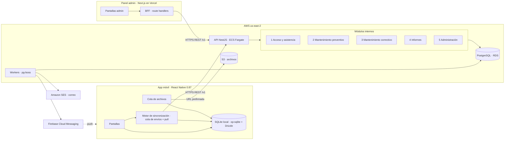

**Qué hace cada módulo:**
- **1. Acceso y asistencia:** identifica a la persona y registra su estancia en un sitio.
- **2. Mantenimiento preventivo:** recibe las inspecciones diarias, las valida y las persiste.
- **3. Mantenimiento correctivo:** convierte hallazgos en fallas y lleva su ciclo de vida.
- **4. Informes:** expone agregados de solo lectura y genera exportaciones.
- **5. Administración:** mantiene el catálogo, los usuarios y los avisos.

**Llamadas síncronas y asíncronas:**
- **Síncrono:**
  - Del cliente a la API.
  - De Preventivo a Correctivo: crear fallas desde los hallazgos ocurre **en la misma transacción** que guarda la inspección, para garantizar que el 100 % de los "Malo" tengan falla (historia #29).
  - De los módulos a Administración, para leer el catálogo y verificar permisos.
- **Asíncrono, mediante transactional outbox y pg-boss:**
  - Todos los avisos: llegada y salida (#48), criticidad A (#49), cumplimiento (#51).
  - Importaciones (#54), exportaciones (#46) y etiquetas (#55).

**Dónde vive el estado compartido:**
- Una sola base PostgreSQL, en la que cada tabla tiene un único módulo dueño (ver el ERD).
- Un módulo nunca escribe en tablas de otro: llama al servicio público de ese módulo.
- Una regla de lint en la API prohíbe importar los repositorios de otro módulo.
- En el teléfono, la base SQLite local es una **réplica parcial**: tiene el catálogo y las fallas de los sitios asignados, más la cola de cambios propios que aún no se envían.

### Protocolo de sincronización (transversal)

Respalda la historia #19 y los NFR "Sin señal" e "Integridad". Lo revisó el DBA el 2026-11-16.

1. **Los IDs los genera el cliente:** todo registro que se crea en el teléfono nace con un UUIDv7. El reenvío es idempotente:
   - Si el ID ya existe **en la misma organización**, la API responde `duplicate` y no hace nada.
   - Si existe en otra organización, responde `rejected ID_CONFLICT`, sin revelar a quién pertenece.
2. **Pull de catálogo y fallas:** `GET /v1/sync/pull?cursors=` lleva **un cursor por entidad**, con forma `(updated_at, id)`.
   - **Quién fija `updated_at`:** siempre la base de datos, con `clock_timestamp()` en un trigger BEFORE. El cliente nunca lo manda.
   - **Traslape:** cada pull vuelve a leer los 2 minutos anteriores al cursor. Los upserts locales son idempotentes, así que no se pierden filas de transacciones largas, como el commit de una importación (#54).
   - **Qué incluye:**
     - sitios, áreas, equipos y plantillas;
     - puntos, incluidos los desactivados, para conservar el historial;
     - `USER_SITE`;
     - las fallas abiertas de los sitios asignados, con sus eventos y hallazgos;
     - el último resultado por equipo.
   - Devuelve como máximo 500 filas por página y por entidad. El catálogo es **solo de lectura** en el teléfono.
   - **Salidas de alcance:** si se revoca un `USER_SITE` o un equipo cambia de sitio, el pull le indica al teléfono qué borrar de su base local.
   - **Expiración:** las filas desactivadas o borradas se conservan 90 días. Un cursor más viejo recibe `410 CURSOR_EXPIRED`, y el teléfono vuelve a descargar el catálogo completo sin tocar su cola de envíos.
3. **Push de mutaciones:** `POST /v1/sync/push` envía en lotes, ordenados, lo que hay en la tabla local `outbox`: llegadas y salidas, **una inspección por equipo** (unos 15 resultados), fallas, eventos de falla y metadatos de archivos.
   - Cada mutación se aplica en su propia transacción y devuelve `applied`, `duplicate` o `rejected` con un código.
   - Una mutación rechazada **no se borra**: queda visible en el teléfono como "requiere atención".
4. **Conflictos:**
   - El teléfono casi solo crea registros. La única edición concurrente posible es sobre una falla, y se resuelve con **eventos que solo se agregan** más el campo `version` de la falla.
   - Si llega un "cerrar" para una falla que ya está cerrada, se guarda el evento como comentario y la API responde `FAULT_ALREADY_CLOSED`. La falla no se reabre.
5. **Hora confiable:**
   - En cada evento el teléfono guarda la hora de su reloj (`client_*_at`) y además el reloj monótono desde el arranque (`elapsedRealtime`).
   - En cada push manda `clientNow` y su `elapsedRealtime` actual. Con eso, el servidor reconstruye la hora real del evento aunque el usuario haya corregido el reloj después, siempre que el teléfono no se haya reiniciado entre medias.
   - El servidor guarda la hora ajustada (`*_at`), la del teléfono (`client_*_at`), el desfase (`clock_skew_s`), la hora de recepción (`received_at`) y la columna generada `needs_review`, que vale verdadero si el desfase supera 300 s.
   - `local_date` es la fecha, en la zona horaria del sitio, de la hora de inicio ya ajustada. El teléfono adopta la que devuelve el servidor.
   - El técnico no puede editar ninguna hora en la app.
6. **Archivos:**
   - Las fotos y firmas se guardan comprimidas en el teléfono: lado mayor de 1600 px, JPEG calidad 0.7, unos 300 KB.
   - Se suben directo a S3 con una URL prefirmada de 5 minutos. El registro de negocio referencia el `media_file_id` aunque la subida todavía no termine.
7. **Versionado:**
   - Cada push incluye `X-Sync-Protocol`. La API soporta la versión actual y la anterior.
   - `organization.settings.min_app_version` permite forzar una actualización.

## Modelo de datos global (ERD)

> **Firmar antes de construir.** El DBA lo revisó el 2026-11-16 con el veredicto "aprobar con correcciones", y las correcciones ya están aplicadas. Falta la firma del PO.
>
> **Todas** las tablas llevan `organization_id`. Para que el diagrama sea legible, solo se dibuja su relación con las entidades raíz. Las reglas de integridad que el diagrama no puede expresar están en §Reglas de integridad en la base.

```mermaid
erDiagram
  ORGANIZATION ||--o{ APP_USER : employs
  ORGANIZATION ||--o{ SITE_TYPE : defines
  ORGANIZATION ||--o{ SITE : operates
  ORGANIZATION ||--o{ EQUIPMENT_TYPE : defines
  ORGANIZATION ||--o{ CHECKLIST_TEMPLATE : defines
  ORGANIZATION ||--o{ MEDIA_FILE : stores
  ORGANIZATION ||--o{ IMPORT_JOB : runs
  ORGANIZATION ||--o{ AUDIT_EVENT : logs
  ORGANIZATION ||--o{ REPORT_EXPORT : requests

  SITE_TYPE ||--o{ SITE : classifies
  SITE ||--o{ AREA : contains
  SITE ||--o{ EQUIPMENT : hosts
  AREA |o--o{ EQUIPMENT : groups
  EQUIPMENT_TYPE ||--o{ EQUIPMENT : types
  EQUIPMENT_TYPE |o--o{ CHECKLIST_TEMPLATE : "default for"
  CHECKLIST_TEMPLATE ||--|{ CHECKLIST_ITEM : contains
  CHECKLIST_TEMPLATE ||--o{ EQUIPMENT : "applied to"
  SITE }o--o| MEDIA_FILE : photo
  EQUIPMENT }o--o| MEDIA_FILE : photo

  APP_USER ||--o{ USER_SITE : "assigned via"
  SITE ||--o{ USER_SITE : "staffed via"
  APP_USER ||--o{ USER_INVITATION : receives
  APP_USER ||--o{ DEVICE : uses
  APP_USER ||--o{ NOTIFICATION_PREFERENCE : sets
  APP_USER ||--o{ NOTIFICATION : receives
  APP_USER ||--o{ AUDIT_EVENT : performs
  APP_USER ||--o{ IMPORT_JOB : uploads
  IMPORT_JOB }o--|| MEDIA_FILE : "source file"

  APP_USER ||--o{ AUTH_SESSION : opens
  DEVICE |o--o{ AUTH_SESSION : holds
  APP_USER ||--o{ PASSWORD_RESET : requests
  APP_USER ||--o{ SITE_VISIT : records
  SITE ||--o{ SITE_VISIT : "visited in"

  SITE_VISIT |o--o{ INSPECTION : "context of"
  APP_USER ||--o{ INSPECTION : performs
  SITE ||--o{ INSPECTION : "inspected in"
  AREA |o--o{ INSPECTION : covers
  EQUIPMENT ||--o{ INSPECTION : "inspected by"
  CHECKLIST_TEMPLATE ||--o{ INSPECTION : "template used"
  INSPECTION }o--o| MEDIA_FILE : "signed with"
  INSPECTION ||--|{ INSPECTION_RESULT : records
  CHECKLIST_ITEM ||--o{ INSPECTION_RESULT : "answered by"
  INSPECTION_RESULT ||--o{ INSPECTION_RESULT_MEDIA : has
  MEDIA_FILE ||--o{ INSPECTION_RESULT_MEDIA : "attached as"

  SITE ||--o{ FAULT : "located in"
  EQUIPMENT ||--o{ FAULT : has
  CHECKLIST_ITEM |o--o{ FAULT : originates
  APP_USER ||--o{ FAULT : reports
  APP_USER |o--o{ FAULT : "assigned to"
  FAULT ||--o{ FAULT_FINDING : groups
  INSPECTION_RESULT ||--o| FAULT_FINDING : "raised as"
  FAULT ||--|{ FAULT_EVENT : "timeline of"
  APP_USER ||--o{ FAULT_EVENT : authors
  FAULT_EVENT ||--o{ FAULT_EVENT_MEDIA : has
  MEDIA_FILE ||--o{ FAULT_EVENT_MEDIA : "attached as"

  APP_USER ||--o{ REPORT_EXPORT : requests
  REPORT_EXPORT }o--o| MEDIA_FILE : outputs

  ORGANIZATION {
    uuid id PK
    text name
    text slug
    text default_timezone
    text locale
    jsonb settings
    timestamptz created_at
    timestamptz updated_at
  }
  APP_USER {
    uuid id PK
    uuid organization_id FK
    text email
    text full_name
    text role
    text status
    text password_hash
    timestamptz last_login_at
    timestamptz created_at
    timestamptz updated_at
  }
  USER_INVITATION {
    uuid id PK
    uuid organization_id FK
    uuid user_id FK
    uuid invited_by FK
    text token_hash
    timestamptz expires_at
    timestamptz accepted_at
  }
  USER_SITE {
    uuid user_id PK, FK
    uuid site_id PK, FK
    uuid organization_id FK
    timestamptz created_at
    timestamptz updated_at
    timestamptz deleted_at
  }
  SITE_TYPE {
    uuid id PK
    uuid organization_id FK
    text name
    int position
    timestamptz created_at
    timestamptz updated_at
    timestamptz deactivated_at
  }
  SITE {
    uuid id PK
    uuid organization_id FK
    uuid site_type_id FK
    uuid photo_file_id FK
    text code
    text name
    text timezone
    timestamptz created_at
    timestamptz updated_at
    timestamptz deactivated_at
  }
  AREA {
    uuid id PK
    uuid organization_id FK
    uuid site_id FK
    text code
    text name
    int position
    timestamptz created_at
    timestamptz updated_at
    timestamptz deactivated_at
  }
  EQUIPMENT_TYPE {
    uuid id PK
    uuid organization_id FK
    text name
    timestamptz created_at
    timestamptz updated_at
    timestamptz deactivated_at
  }
  EQUIPMENT {
    uuid id PK
    uuid organization_id FK
    uuid site_id FK
    uuid area_id FK
    uuid equipment_type_id FK
    uuid checklist_template_id FK
    uuid photo_file_id FK
    text tag
    text asset_number
    text name
    text criticality
    int position
    text qr_token
    timestamptz created_at
    timestamptz updated_at
    timestamptz deactivated_at
  }
  CHECKLIST_TEMPLATE {
    uuid id PK
    uuid organization_id FK
    uuid equipment_type_id FK
    text name
    timestamptz created_at
    timestamptz updated_at
    timestamptz deactivated_at
  }
  CHECKLIST_ITEM {
    uuid id PK
    uuid organization_id FK
    uuid checklist_template_id FK
    uuid lineage_id
    int position
    text label
    boolean allows_na
    timestamptz created_at
    timestamptz updated_at
    timestamptz deactivated_at
  }
  IMPORT_JOB {
    uuid id PK
    uuid organization_id FK
    uuid uploaded_by FK
    uuid source_file_id FK
    text status
    jsonb validation_report
    int rows_total
    int rows_failed
    timestamptz created_at
    timestamptz committed_at
  }
  DEVICE {
    uuid id PK
    uuid organization_id FK
    uuid user_id FK
    text platform
    text push_token
    text app_version
    timestamptz last_seen_at
  }
  NOTIFICATION_PREFERENCE {
    uuid user_id PK, FK
    text event_type PK
    uuid organization_id FK
    boolean push_enabled
    boolean email_enabled
  }
  NOTIFICATION {
    uuid id PK
    uuid organization_id FK
    uuid user_id FK
    text event_type
    text channel
    jsonb payload
    timestamptz sent_at
    timestamptz opened_at
  }
  AUDIT_EVENT {
    uuid id PK
    uuid organization_id FK
    uuid actor_id FK
    text action
    text entity_type
    uuid entity_id
    jsonb diff
    timestamptz created_at
  }
  AUTH_SESSION {
    uuid id PK
    uuid organization_id FK
    uuid user_id FK
    uuid device_id FK
    uuid family_id
    uuid replaced_by_id FK
    text refresh_token_hash
    timestamptz created_at
    timestamptz expires_at
    timestamptz revoked_at
  }
  PASSWORD_RESET {
    uuid id PK
    uuid organization_id FK
    uuid user_id FK
    text token_hash
    timestamptz expires_at
    timestamptz used_at
  }
  SITE_VISIT {
    uuid id PK
    uuid organization_id FK
    uuid user_id FK
    uuid site_id FK
    boolean first_visit_of_day
    boolean last_visit_of_day
    boolean auto_closed
    timestamptz arrived_at
    timestamptz departed_at
    timestamptz client_arrived_at
    timestamptz client_departed_at
    int clock_skew_s
    boolean needs_review
    timestamptz received_at
    timestamptz updated_at
  }
  INSPECTION {
    uuid id PK
    uuid organization_id FK
    uuid site_id FK
    uuid area_id FK
    uuid equipment_id FK
    uuid checklist_template_id FK
    uuid site_visit_id FK
    uuid inspector_id FK
    uuid signature_file_id FK
    date local_date
    text open_method
    text comments
    timestamptz started_at
    timestamptz completed_at
    timestamptz client_started_at
    timestamptz client_completed_at
    int clock_skew_s
    boolean needs_review
    timestamptz received_at
  }
  INSPECTION_RESULT {
    uuid inspection_id PK, FK
    uuid checklist_item_id PK, FK
    uuid organization_id FK
    text outcome
    text note
    timestamptz recorded_at
  }
  MEDIA_FILE {
    uuid id PK
    uuid organization_id FK
    uuid uploaded_by FK
    text storage_key
    text mime_type
    int size_bytes
    bytea sha256
    text upload_status
    timestamptz created_at
  }
  INSPECTION_RESULT_MEDIA {
    uuid inspection_id PK, FK
    uuid checklist_item_id PK, FK
    uuid media_file_id PK, FK
    uuid organization_id FK
  }
  FAULT {
    uuid id PK
    uuid organization_id FK
    uuid site_id FK
    uuid equipment_id FK
    uuid checklist_item_id FK
    uuid item_lineage_id
    uuid reported_by FK
    uuid assigned_to FK
    text source
    text status
    text urgency
    text criticality_at_open
    text description
    text hold_reason
    int version
    timestamptz opened_at
    timestamptz closed_at
    timestamptz updated_at
  }
  FAULT_FINDING {
    uuid inspection_id PK, FK
    uuid checklist_item_id PK, FK
    uuid fault_id FK
    uuid organization_id FK
    timestamptz linked_at
  }
  FAULT_EVENT {
    uuid id PK
    uuid organization_id FK
    uuid fault_id FK
    uuid actor_id FK
    text event_type
    text body
    timestamptz occurred_at
    timestamptz client_occurred_at
    int clock_skew_s
    timestamptz received_at
  }
  FAULT_EVENT_MEDIA {
    uuid fault_event_id PK, FK
    uuid media_file_id PK, FK
    uuid organization_id FK
  }
  REPORT_EXPORT {
    uuid id PK
    uuid organization_id FK
    uuid requested_by FK
    uuid result_file_id FK
    text report_type
    jsonb params
    text status
    timestamptz created_at
    timestamptz completed_at
  }
```

| Entidad | Módulo dueño | Se relaciona con | Cardinalidad | Notas |
|---|---|---|---|---|
| ORGANIZATION | 5 Administración | Todas las entidades raíz | 1:N | Tenant. `settings` guarda flags, `min_app_version`, `shift_end` y `operating_days` |
| APP_USER | 5 Administración | SITE (vía USER_SITE), SITE_VISIT, INSPECTION, FAULT… | 1:N | PII: nombre y correo. `email` es único global. `role` ∈ {technician, admin}. `status` ∈ {invited, active, disabled} |
| USER_INVITATION | 5 Administración | APP_USER | N:1 | Solo se guarda el hash del token. Expira en 7 días |
| USER_SITE | 5 Administración | APP_USER ↔ SITE | **N:M (tabla puente)** | Borrado lógico (`deleted_at`) para que la revocación llegue al teléfono |
| SITE_TYPE | 5 Administración | SITE | 1:N | Lo configura cada organización: Fijo, Mini, Móvil, Planta… |
| SITE | 5 Administración | AREA, EQUIPMENT, SITE_VISIT, INSPECTION, FAULT | 1:N | `timezone` define qué es "hoy" para los pendientes |
| AREA | 5 Administración | EQUIPMENT, INSPECTION | 1:N | Es opcional; los equipos independientes no tienen área |
| EQUIPMENT_TYPE | 5 Administración | EQUIPMENT, CHECKLIST_TEMPLATE | 1:N | Banda, criba, trituradora, alimentador vibratorio, tolva… |
| EQUIPMENT | 5 Administración | INSPECTION, FAULT | 1:N | `position` conserva el orden del flujo de proceso del formulario. `created_at` y `deactivated_at` definen cuándo cuenta como "esperado" |
| CHECKLIST_TEMPLATE | 5 Administración | CHECKLIST_ITEM, EQUIPMENT, INSPECTION | 1:N | En v1 todas son diarias; no hay columna de frecuencia (#28 Won't) |
| CHECKLIST_ITEM | 5 Administración | INSPECTION_RESULT, FAULT | 1:N | Inmutable en `label`, `allows_na` y plantilla. Editar crea una versión nueva con el mismo `lineage_id` |
| IMPORT_JOB | 5 Administración | MEDIA_FILE (origen) | N:1 | `validation_report` lista los errores por fila |
| DEVICE | 5 Administración | APP_USER, AUTH_SESSION | N:1 | Token push de FCM |
| NOTIFICATION_PREFERENCE | 5 Administración | APP_USER | N:1 | PK compuesta (usuario, tipo de evento) |
| NOTIFICATION | 5 Administración | APP_USER | N:1 | Bitácora de envíos y aperturas (analítica) |
| AUDIT_EVENT | 5 Administración | APP_USER | N:1 | Solo se agregan filas. `diff` excluye secretos y hashes |
| AUTH_SESSION | 1 Acceso y asistencia | APP_USER, DEVICE | N:1 | **Cruza módulos** hacia el módulo 5. Refresh token rotativo; `family_id` sirve para detectar reutilización |
| PASSWORD_RESET | 1 Acceso y asistencia | APP_USER | N:1 | Hash del token. Expira en 30 minutos y es de un solo uso |
| SITE_VISIT | 1 Acceso y asistencia | APP_USER, SITE, INSPECTION | N:1 | **Cruza módulos** hacia SITE. `auto_closed` marca los cierres automáticos de las 23:59 |
| INSPECTION | 2 Mantenimiento preventivo | SITE, AREA, EQUIPMENT, CHECKLIST_TEMPLATE, SITE_VISIT, APP_USER, MEDIA_FILE | N:1 | **Una fila por equipo inspeccionado** (decisión del PO tras la revisión del DBA). `area_id` es una foto del momento. La hoja de área es la agrupación (area_id, local_date, inspector_id). Inmutable |
| INSPECTION_RESULT | 2 Mantenimiento preventivo | INSPECTION, CHECKLIST_ITEM, FAULT_FINDING | N:1 | PK natural (inspection_id, checklist_item_id): un punto, una respuesta. `outcome` ∈ {good, bad, na}. Inmutable |
| MEDIA_FILE | 2 Mantenimiento preventivo | Resultados, eventos de falla, equipos, sitios, importaciones, exportaciones | 1:N | **Lo usan los 5 módulos.** Una firma se reutiliza en todas las inspecciones de la ronda (#22) |
| INSPECTION_RESULT_MEDIA | 2 Mantenimiento preventivo | INSPECTION_RESULT ↔ MEDIA_FILE | **N:M (tabla puente)** | Fotos de un hallazgo (#21) |
| FAULT | 3 Mantenimiento correctivo | SITE, EQUIPMENT, CHECKLIST_ITEM, APP_USER | N:1 | **Cruza módulos.** `status` ∈ {open, on_hold, closed} (máquina de estados). `site_id` evita joins en el pull. `criticality_at_open` alimenta el KPI de fallas A |
| FAULT_FINDING | 3 Mantenimiento correctivo | FAULT, INSPECTION_RESULT | N:1 / 1:0..1 | **Cruza módulos** hacia el módulo 2. PK = la del resultado: cada hallazgo pertenece a una sola falla |
| FAULT_EVENT | 3 Mantenimiento correctivo | FAULT, APP_USER | N:1 | Solo se agregan eventos. `event_type` ∈ {reported, comment, assigned, on_hold, resumed, action, closed} |
| FAULT_EVENT_MEDIA | 3 Mantenimiento correctivo | FAULT_EVENT ↔ MEDIA_FILE | **N:M (tabla puente)** | Evidencia de la corrección |
| REPORT_EXPORT | 4 Informes | APP_USER, MEDIA_FILE | N:1 | El archivo resultante vive en S3 y expira a los 7 días |

**Recortado del piloto, por recomendación del DBA:**
- La tabla INSPECTION_EQUIPMENT: se absorbió en INSPECTION.
- La frecuencia de las plantillas.
- Las columnas para el valor opcional de un punto (#24, Could) y para repuestos (#38, Could). Agregarlas después como columnas nulas es un cambio solo de metadatos.
- El particionado y las vistas materializadas.

### Reglas de integridad en la base

- **Multiempresa con integridad referencial:**
  - Cada tabla padre tiene `UNIQUE (id, organization_id)`, y cada hija la referencia con una FK compuesta `(padre_id, organization_id)`. Así ninguna fila puede apuntar a datos de otra empresa, aunque el ID venga del teléfono. Las FK ignoran las RLS; esta regla cierra ese hueco.
  - FK compuestas `(area_id, site_id) → area(id, site_id)` en EQUIPMENT e INSPECTION, con MATCH SIMPLE, que permite área nula. Garantizan que el área pertenezca al sitio.
- **Row-Level Security:**
  - `ENABLE` + `FORCE ROW LEVEL SECURITY` en todas las tablas.
  - Política `organization_id = current_setting('app.organization_id', true)::uuid`. Si la sesión no fijó la organización, no ve nada.
  - Roles separados:
    - el dueño de las migraciones;
    - el rol de la app, sujeto a RLS;
    - un rol estrecho para el login, que busca por correo;
    - un rol para pg-boss.
- **Inmutabilidad:** el rol de la app no tiene UPDATE ni DELETE sobre INSPECTION, INSPECTION_RESULT, INSPECTION_RESULT_MEDIA, FAULT_EVENT ni AUDIT_EVENT.
- **CHECK:**
  - INSPECTION_RESULT:
    - `outcome IN ('good','bad','na')`;
    - `outcome <> 'bad' OR btrim(note) <> ''`;
    - `na` solo si el punto tiene `allows_na`. Esto se valida con un trigger, porque cruza tablas.
  - FAULT:
    - `(status = 'closed') = (closed_at IS NOT NULL)`;
    - `status <> 'on_hold' OR hold_reason IS NOT NULL`.
  - SITE_VISIT: `departed_at IS NULL OR departed_at >= arrived_at`.
- **Únicos:**

| Tabla | Regla |
|---|---|
| SITE_VISIT | `(user_id) WHERE departed_at IS NULL` |
| FAULT | `(equipment_id, item_lineage_id) WHERE status IN ('open','on_hold')`. Los `ON CONFLICT` repiten este predicado |
| EQUIPMENT | `(organization_id, tag)`, `(organization_id, asset_number)` y `qr_token` único global, porque el enlace de la etiqueta se resuelve antes de conocer la organización |
| SITE | `(organization_id, code)` |
| CHECKLIST_TEMPLATE | `(organization_id, name)` |
| CHECKLIST_ITEM | `(checklist_template_id, label) WHERE deactivated_at IS NULL` |

- **Historial de puntos:** un trigger bloquea el UPDATE de `label`, `allows_na` y `checklist_template_id` en CHECKLIST_ITEM. Editar un punto crea uno nuevo con el mismo `lineage_id` y desactiva el anterior.
- **Hallazgo ⇒ falla:** un constraint trigger `DEFERRABLE INITIALLY DEFERRED` sobre INSPECTION_RESULT, `WHEN (NEW.outcome = 'bad')`, exige su FAULT_FINDING al hacer commit. Además hay una conciliación nocturna.
- **Borrado:**
  - Nunca hay borrado físico en el catálogo.
  - Cada entidad usa una sola columna: `deactivated_at` en el catálogo y `deleted_at` en USER_SITE.
  - Las FK son `ON DELETE RESTRICT` por defecto. La excepción es `INSPECTION.site_visit_id ON DELETE SET NULL`, porque la asistencia se purga a los 24 meses y las inspecciones no.
- **`updated_at`:** lo fija un trigger BEFORE con `clock_timestamp()` en todas las tablas que se sincronizan.

### Índices clave

| Tabla | Índice | Para |
|---|---|---|
| Todas las que se sincronizan | `(organization_id, updated_at, id)` | Cursor del pull |
| INSPECTION | `(organization_id, site_id, local_date, equipment_id)` | Pendientes (#26), cumplimiento (#40) |
| INSPECTION | `(equipment_id, completed_at DESC)` | Inspección anterior (#23) |
| INSPECTION_RESULT | La PK `(inspection_id, checklist_item_id)` | Detalle (#41) |
| INSPECTION_RESULT | Parcial `(organization_id, checklist_item_id) WHERE outcome = 'bad'` | Focos de hallazgos (#43), unas 50 veces más chico que un índice completo |
| FAULT | Parcial `(equipment_id) WHERE status IN ('open','on_hold')` | Lista de fallas (#31) |
| FAULT | `(organization_id, site_id, updated_at, id)` | Pull por sitio |
| SITE_VISIT | `(organization_id, site_id, arrived_at DESC)` | Asistencia (#45) |

**Volumen a 500 sitios:** unos 4.7 M de inspecciones y 70 M de resultados por año.
- El particionado se pospone. La PK de INSPECTION_RESULT ya permite particionar por hash de `inspection_id` cuando la tabla pase de 100 M de filas.
- No se particiona por rango sobre el UUIDv7, porque su marca de tiempo viene del reloj del teléfono.

**Lista para la firma:**
- [x] Cada entidad tiene exactamente un módulo dueño.
- [x] Las tres relaciones N:M tienen tabla puente explícita.
- [x] Las FK que cruzan módulos están señaladas.
- [x] No hay entidades huérfanas.
- [x] Revisión de DBA: "aprobar con correcciones", aplicadas el 2026-11-16.
- [ ] **Pendiente:** firma del PO.

## Arquitectura de repositorios

| Repositorio | Propósito | Contiene (módulos) |
|---|---|---|
| `MaintenanceApp` (existente) | App móvil React Native para técnicos y administradores | Lado cliente de los módulos 1–5: flujo del técnico completo, más avisos e informes para el rol de administrador |
| `maintenance-api` (nuevo) | API NestJS, workers, migraciones de base de datos, especificación OpenAPI | Lado servidor de los módulos 1–5 |
| `maintenance-admin` (nuevo) | Panel web Next.js para el administrador | Módulos 4 y 5, y consulta del 3 |

**Contrato compartido.** La CI de `maintenance-api` genera la especificación OpenAPI 3.1 y publica el paquete `@maintenanceapp/api-client` en GitHub Packages, con los tipos y un cliente tipado. Los otros dos repos lo consumen con una versión fija. Así, un cambio incompatible en la API aparece como error de tipos en sus CI.

## Stack y elección de frameworks

| Capa | Elección | Razón | Alternativas descartadas |
|---|---|---|---|
| Móvil | React Native 0.87.1 (CLI), React Navigation 7. Migración gradual a TypeScript. Base Designli: NativeWind en pantallas nuevas, Zustand, react-native-config, toasts | Ya está actualizado y funciona en Android e iOS. Sigue el stack estándar de Designli | Expo (el proyecto ya es bare). Reescribir en Flutter (sin justificación) |
| Base local (sin conexión) | **op-sqlite** (SQLite vía JSI, con cifrado SQLCipher) + **Drizzle ORM** para el esquema y las migraciones locales. Sincronización propia (§Protocolo) | Es SQLite, como pidió el PO. Tiene mantenimiento activo (19.0.5, 2026-11-05), funciona con la New Architecture y Drizzle lo soporta oficialmente | **WatermelonDB**: usa SQLite, pero su última versión estable es la 0.28.0 (abr-2025). En RN ≥ 0.82 la New Architecture es obligatoria y su soporte no es oficial; hay reportes de fallas en 0.82–0.83 y el autor está reescribiéndolo sobre Nitro modules. Se reevalúa cuando salga esa versión. **Realm / Atlas Device SDK**: deprecado por MongoDB. **PowerSync**: otro servicio con costo mensual, innecesario porque el teléfono casi solo crea registros. **AsyncStorage**: no permite consultas ni transacciones |
| Escáner QR | react-native-vision-camera (5.x) con su lector de códigos | Mantenido y compatible con la New Architecture. Lee QR con poca luz | Librerías de cámara sin mantenimiento |
| Push | @react-native-firebase/messaging + Notifee | Es el estándar de Designli. FCM también entrega en iOS mediante APNs | Expo Notifications (proyecto bare). SNS Mobile Push (más configuración) |
| Backend | NestJS + TypeScript, Node 24 LTS, Prisma | Es el estándar de Designli. Los módulos de NestJS se corresponden con los del PRD | Microservicios (exceso para un piloto de unos 15 usuarios). Rails (fuera del estándar) |
| Base de datos | PostgreSQL 17 en RDS, con Row-Level Security por `organization_id` | Estándar Designli. Las RLS dan aislamiento entre empresas como segunda capa de defensa | MongoDB (los datos son relacionales). Un esquema por empresa (más costoso de operar con muchas empresas) |
| Autenticación | **Propia**: argon2id + JWT de acceso de 15 min (EdDSA, llaves rotables vía JWKS) + refresh token opaco rotativo de 30 días con detección de reutilización | Decisión del PO: un producto multiempresa evita el costo por usuario activo de Auth0 | Auth0 (costo por MAU). Supabase Auth y Cognito (dependencia extra, sin necesidad de SSO en v1, ver #4 Won't) |
| Colas y tareas | pg-boss sobre la misma base PostgreSQL | No agrega infraestructura y permite encolar dentro de la transacción del negocio | SQS + Lambda (más infraestructura para el piloto). BullMQ (requiere Redis) |
| Panel web | Next.js (App Router) + TypeScript en Vercel. El BFF guarda la sesión en cookies httpOnly | Estándar Designli. Los tokens nunca quedan accesibles al JavaScript del navegador | SPA con los tokens en localStorage (riesgo XSS) |
| Infraestructura | AWS us-east-2: ECS Fargate (API y workers), RDS, S3 (SSE), SES, Secrets Manager, CloudWatch | Proceso estándar de Designli (MAU) y región preferida | VPS (más operación manual y sin PITR administrado) |
| Archivos y documentos | Excel en el servidor con exceljs dentro de un worker. PDF de etiquetas generado en el servidor | Los VOSOA nacen en Excel; las etiquetas deben salir iguales en cualquier navegador | Procesar el Excel en el navegador (sin validación central) |
| Observabilidad | Sentry (móvil, API y web), PostHog (eventos de producto), CloudWatch (logs y métricas) | Estándar Designli | Datadog (costo para el piloto) |
| CI/CD | GitHub Actions + SonarCloud. Fastlane para la app (internal track de Android y TestFlight) | Estándar Designli | — |

## Integraciones entre módulos y dependencias externas

| Dependencia | Módulos que la usan | Propósito | Modo de falla | Plan B |
|---|---|---|---|---|
| Firebase Cloud Messaging (+APNs) | 5 (avisos de #48, #49, #51) | Push al administrador | No se entrega, o Android lo retrasa por ahorro de batería | Los avisos de criticidad A también se mandan por correo (SES). La bandeja de avisos dentro de la app es la fuente de verdad |
| Amazon SES | 1 (#3), 5 (invitaciones #57, avisos) | Correo transaccional | Se rechaza o se retrasa | Reintentos con backoff vía pg-boss. El administrador puede reenviar invitaciones |
| Amazon S3 | 2, 3, 4, 5 | Fotos, firmas, Excel, PDFs, exportaciones | La subida falla | El archivo queda en la cola del teléfono con reintentos. El registro de negocio no se bloquea porque el archivo está desacoplado |
| RDS PostgreSQL | Todos | Datos | Caída de la instancia | Restauración PITR (RPO ≤ 5 min). La app móvil sigue trabajando sin conexión |
| Vercel | Panel web | Hosting del panel | Caída | El administrador consulta avisos e informes en la app móvil. Los catálogos esperan |
| Sentry / PostHog | Todos | Errores y analítica | Caída o bloqueo por ad-blockers | No bloquean la operación. Los eventos críticos se derivan de la base de datos, no de PostHog |
| Llamada interna 2 → 3 | Preventivo → Correctivo | Crear fallas desde hallazgos | Error en Correctivo | Comparten transacción: si falla, se rechaza la inspección completa y el teléfono reintenta. Nunca queda una inspección guardada con un hallazgo sin falla |

## Requisitos no funcionales globales (con presupuestos)

| Categoría | Requisito | Meta | Respalda (PRD) |
|---|---|---|---|
| Sin señal | Flujos del técnico (módulos 1–3) que funcionan sin red | 100 % | "Puedo hacer toda mi ronda sin conexión" |
| Sin señal | Registros perdidos (cola local vs. servidor, conciliación diaria) | 0 en el piloto | "…y nada se pierde" |
| Sin señal | Sincronizar la inspección de un equipo (~15 resultados, sin fotos) en 1 Mbps | p95 < 3 s | "Lo pendiente se envía solo" |
| Sin señal | Antigüedad máxima en la cola con conexión disponible | < 2 min | "…cuando vuelve la señal" |
| Uso en campo | Áreas táctiles de acciones primarias y del Bueno/Malo | ≥ 48 × 48 dp | "Puedo usar la app con guantes" |
| Uso en campo | Contraste del texto y de los controles primarios | ≥ 7:1 (WCAG AAA 1.4.6) | "…y a pleno sol" |
| Uso en campo | Toques por punto de verificación marcado como Bueno | 1 | "…pocos toques por punto" |
| Rapidez | Abrir la lista de verificación de un equipo de 17 puntos en el dispositivo de referencia | p95 < 300 ms | "Se siente inmediato" |
| Rapidez | Respuesta visual al marcar un punto (escritura local) | p95 < 50 ms | "Se siente inmediato" |
| Rapidez | Arranque en frío de la app hasta la pantalla útil | < 3 s | — |
| Rapidez | Latencia de lectura de la API | p95 < 300 ms | — |
| Rapidez | Lote de `sync/push` (≤ 200 mutaciones) | p95 < 800 ms en el servidor | — |
| Dispositivos | Android y iOS mínimos | Android 7.0+ (API 24) · iOS 15.1+, por los mínimos de RN 0.87 | "Funciona en teléfonos de hace 3 o 4 años" |
| Dispositivos | Dispositivo de referencia para presupuestos | Android de gama media de 2022 con 3 GB de RAM (a confirmar, pregunta T3) | "Android es la prioridad" |
| Integridad | Horas registradas | Ajustadas por el servidor; desfase > 300 s marcado. No editables en la UI | "La fecha y la hora… no las puede editar" |
| Privacidad | Accesos entre empresas | 0. Prueba automatizada en CI para cada endpoint y política RLS activa | "Una empresa nunca ve los datos de otra" |
| Privacidad | Alcance del técnico | Solo los sitios de USER_SITE, aplicado en la API y en el pull | "Un técnico solo ve sus sitios asignados" |
| Idioma | Textos externalizados | 100 % en catálogos i18n (es-419) | "Todo en español" |
| Legibilidad | Escalado de fuente del sistema sin cortar acciones primarias | Hasta 200 % (WCAG 1.4.4) | "Respeta el tamaño de letra" |
| Confiabilidad | Disponibilidad de la API | 99.5 % mensual (piloto); 99.9 % desde Fase 4 | — |
| Confiabilidad | Durabilidad | RPO ≤ 5 min (PITR), RTO ≤ 4 h | "Nada se pierde" |
| Escala | Volumen diseñado | 50 organizaciones · 500 sitios · ~4.7 M de inspecciones y ~70 M de resultados por año, sin particionar. La PK de resultados permite particionar por hash de `inspection_id` al pasar de 100 M filas | — |
| Seguridad | Cifrado | TLS 1.2+ en tránsito. AES-256 en RDS y S3. SQLCipher en el teléfono | — |

## Seguridad y cumplimiento

- **Autenticación (módulo 1):**
  - Contraseñas con argon2id (m = 64 MB, t = 3) y un mínimo de 10 caracteres, contrastadas con una lista local de contraseñas comunes.
  - Límites de intento: 5 por minuto por IP + correo, y bloqueo de 15 minutos tras 10 fallos.
  - Token de acceso JWT de 15 minutos, firmado con EdDSA; las llaves rotan cada 90 días y se publican en JWKS.
  - Refresh token opaco de 30 días con expiración deslizante. Se guarda con hash, rota en cada uso, y si se reutiliza uno ya usado se revoca toda la familia.
  - En el teléfono los tokens van en el Keychain/Keystore (react-native-keychain). En el panel, en cookies httpOnly + Secure + SameSite=Lax.
  - **Sin conexión:** la app sigue funcionando sin un token vigente. La cola guarda el `user_id` y solo se envía tras renovar la sesión de **ese mismo** usuario.
- **Autorización:**
  - Por rol (`technician`, `admin`) más alcance por sitio (USER_SITE).
  - Se aplica en guards de NestJS por endpoint y, como segunda capa, con RLS forzadas que fallan cerradas si la sesión no fijó la organización, más FK compuestas por `organization_id` (§Reglas de integridad en la base).
  - Un acceso denegado a otra organización responde `404`, para no revelar que el recurso existe. Uno denegado por rol responde `403`.
- **Clasificación de datos:**
  - **PII:** nombre y correo (APP_USER) y la asistencia (quién estuvo dónde y cuándo).
  - Las fotos pueden mostrar personas; la guía de uso pide fotografiar solo el equipo.
  - No se guarda GPS. La sugerencia de sitio cercano (#11, Could) se calcula en el teléfono y la ubicación nunca se envía.
- **Retención:** inspecciones y fallas indefinidamente, porque son el historial de mantenimiento del activo. Asistencia 24 meses, configurable por organización. Exportaciones 7 días. Sesiones revocadas 90 días.
- **Baja de usuario (#58):** se pone `status=disabled` y se revocan sus sesiones en ≤ 1 minuto. Si se pide borrar sus datos, se anonimizan nombre y correo y se conserva el historial.
- **Datos regulados:** no hay salud ni pagos. La ley de protección de datos de El Salvador y las políticas corporativas del cliente quedan por confirmar (pregunta T5).

**Modelo de amenazas (top 6):**

| Amenaza | Control |
|---|---|
| Relleno de credenciales | argon2id, límites de intento, bloqueo, lista de contraseñas comunes |
| Acceso a datos de otra empresa (IDOR) | Scoping obligatorio por `organization_id`, RLS, suite de pruebas cross-tenant en CI |
| Teléfono robado | Base local cifrada con SQLCipher y llave en Keystore/Keychain; revocación remota de sesiones al desactivar al usuario |
| Inspecciones falsas u horas manipuladas | Hora ajustada por el servidor y desfase marcado, `open_method=scan`, duración visible en Informes (§Riesgos en el PRD) |
| Archivos maliciosos (Excel o imágenes) | URL prefirmada con tipo y tamaño fijos (≤ 10 MB por imagen, ≤ 20 MB por Excel), validación del tipo real, parseo en un worker aislado con límites de filas y tiempo |
| Robo del refresh token | Rotación más detección de reutilización, que revoca la familia completa |

Antes de la Fase 2 (piloto) se hace una revisión OWASP ASVS L2 y un pentest externo ligero.

## Estrategia de observabilidad

### Tableros globales

| Tablero | Audiencia | Responde (PRD §Preguntas de analítica) |
|---|---|---|
| Cumplimiento de inspecciones | Producto y cliente | % de inspecciones completadas por sitio, área y día (pregunta 1) |
| Calidad de inspección | Producto | Duración por tipo de equipo, inspecciones sospechosamente rápidas (< 3 s por punto) (pregunta 2) |
| Hallazgos | Producto y cliente | % de Malo por equipo, tipo de equipo y punto (pregunta 3) |
| Ciclo de fallas | Producto y cliente | Tiempo de hallazgo a cierre por criticidad; manual vs. inspección (preguntas 4 y 5) |
| Adopción | Producto | Escaneo vs. lista (pregunta 6); retención semanal de técnicos y abandono tras la semana 2 (pregunta 9) |
| Salud de la sincronización | Ingeniería | Trabajo sin conexión, antigüedad de la cola, lotes rechazados (pregunta 7) |
| Avisos | Producto | Enviados, abiertos e ignorados por tipo (pregunta 8) |
| Salud de la API | Ingeniería | p95, errores 5xx, saturación de RDS y de la cola pg-boss |

Las preguntas 1, 3, 4 y 5 se responden **desde la base de datos** (vistas del módulo 4), no desde PostHog, para que los bloqueadores de anuncios no las sesguen.

### Alertas globales

| Alerta | Condición | Severidad | Runbook |
|---|---|---|---|
| Rechazos de sincronización | `sync_mutation_rejected` > 2 % de las mutaciones en 1 h | P1 | Runbook de sincronización: revisar los códigos de rechazo y la versión de la app |
| Posible pérdida de datos | La conciliación diaria encuentra registros en la cola de algún teléfono > 24 h con el dispositivo en línea | P1 | Runbook de conciliación |
| Errores de la API | 5xx > 1 % durante 15 min | P1 | Runbook de rollback de la API |
| Latencia de la API | p95 > 1 s durante 15 min | P2 | Runbook de rendimiento |
| Cola pg-boss atascada | Jobs pendientes > 500 o el más antiguo > 10 min | P2 | Runbook de workers |
| Estabilidad de la app | Sesiones sin crash < 99.5 % en 24 h (Sentry) | P1 durante el piloto | Detener el rollout escalonado |
| Avisos críticos | Aviso de criticidad A no entregado (push y correo) en 5 min | P2 | Runbook de avisos |

## Estrategia de pruebas

- **Rutas críticas del PRD:**
  - Llegada y salida: #5–#8.
  - Inspección completa: #15–#20, incluidas la descripción obligatoria (#16) y el bloqueo de inspecciones incompletas (#20).
  - Sin conexión (#19).
  - Hallazgo que genera falla, incluida la agrupación: #29 y #32.
  - Cierre de falla: #34 y #35.
  - Cumplimiento: #26 y #40.
  - Avisos de criticidad A: #49.
  - Importación de Excel: #54.
  - Alcance por sitio: #57.
- **Pruebas unitarias:**
  - Servicios de dominio de la API: máquina de estados de FAULT, validación de inspecciones, cálculo de pendientes por zona horaria, desfase de reloj.
  - Motor de sincronización del móvil: cola, reintentos, idempotencia.
  - Meta: ≥ 80 % de líneas en dominio y sincronización. Sin meta global.
- **Integración:**
  - API contra PostgreSQL real con Testcontainers, incluidas las políticas RLS.
  - **Suite cross-tenant:** crea dos organizaciones y verifica que todos los endpoints respondan 404 con datos ajenos.
  - Contrato: Schemathesis contra la especificación OpenAPI; además, el paquete `@maintenanceapp/api-client` rompe la CI de los clientes ante cambios incompatibles.
- **Extremo a extremo:**
  - Detox (estándar Designli) en Android: inspección con modo avión activado y desactivado, cierre forzado de la app a mitad de la inspección, y reintento de sincronización (#19 y #20).
  - Playwright para el panel: importación de Excel con errores y vista previa (#54), alta de usuario (#57).
- **Pruebas de carga:** k6 sobre `sync/push` con 50 teléfonos simultáneos enviando 400 resultados cada uno.
- **QA manual:**
  - Prueba de campo en la semana 0 del piloto: señal por área, legibilidad al sol, uso con guantes, lectura del QR con polvo. No se puede automatizar.
  - Comparar el papel contra la app durante la Fase 2.
- **Antecedentes en el repo:** hoy solo hay un test de render (Jest) en la app. El resto de la estrategia es nueva.

## Estrategia de despliegue

| Fase | Audiencia | Módulos | Criterio para avanzar | Disparador de rollback |
|---|---|---|---|---|
| 0. Spike técnico (1 semana) | Ingeniería | Sincronización y base local | op-sqlite + SQLCipher + Drizzle + vision-camera compilan y corren en RN 0.87, Android e iOS. Insertar 400 resultados en < 200 ms. La cola sobrevive a un cierre forzado | Si op-sqlite no pasa: evaluar expo-sqlite + Drizzle antes de pasar a la Fase 1 |
| 1. Alfa interna | Organización de prueba de Designli, con el catálogo de Tepeagua cargado desde Excel | 1–5 (Must) | Todas las Must pasan E2E. 0 pérdidas en una prueba de 3 días con modo avión intermitente | Cualquier pérdida de datos |
| 2. Piloto en paralelo (2 semanas) | Técnicos y supervisor de Planta Tepeagua, con papel **y** app | 1–5 | Coincidencia papel vs. app ≥ 95 % por punto. Rechazos de sincronización < 1 %. Sesiones sin crash ≥ 99.5 % | Pérdida de datos, sin crash < 99 %, rechazos > 2 % en 1 h: se vuelve solo al papel, que nunca se retiró |
| 3. Piloto sin papel (mes 2) | Planta Tepeagua | 1–5 + Should | Metas leading del PRD (§Métricas) por 2 semanas seguidas | Igual que en la Fase 2. Se reactiva el papel por decisión del supervisor |
| 4. Segunda organización | Una empresa adicional | 1–5 | Metas del PRD a 6 meses | Las de la Fase 2, por organización |

- **Feature flags:** viven en `organization.settings`, llegan por `sync/pull` y los cambia un administrador de plataforma de Designli.

| Flag | Valor inicial | Módulo |
|---|---|---|
| `qr_scan_enabled` | true | 2 (#14) |
| `signature_required` | false | 2 (#22) |
| `photo_required_on_bad` | false | 2 (#21) |
| `notify_site_visits` | true | 5 (#48) |
| `compliance_reminders` | false | 5 (#51) |
| `min_app_version` | — | Global: fuerza la actualización de la app |

- **Migración:** no hay datos productivos que migrar, porque el prototipo solo tiene datos de ejemplo. El catálogo de Tepeagua entra con el importador (#54) desde los Excel originales de los VOSOA (pregunta T1).
  - **Base del servidor:** las migraciones de Prisma siguen el patrón expand/contract y son compatibles con la versión anterior de la app durante 60 días.
  - **Base local:** las migraciones de Drizzle van incluidas en la app. La tabla `outbox` tiene un esquema estable que ninguna migración toca, y antes de migrar se respalda el archivo SQLite.
- **Rollback:**
  - **API:** volver a la task definition anterior de ECS. Las migraciones aditivas no se revierten.
  - **App:** detener el rollout escalonado en Play y TestFlight, apagar la funcionalidad con su flag y, si hace falta, subir `min_app_version` cuando haya una versión corregida.
  - **Piloto:** se vuelve al formulario en papel.

## Riesgos técnicos globales

| Riesgo | Probabilidad | Impacto | Mitigación |
|---|---|---|---|
| op-sqlite o vision-camera fallan con la New Architecture en alguna combinación de dispositivo o SO | Media | Alta | El spike de la Fase 0 cubre Android e iOS. Plan B: expo-sqlite + Drizzle. Fijar versiones exactas |
| Una migración local corrompe la cola de envíos al actualizar la app | Baja | Alta | La tabla `outbox` no se toca en migraciones. Respaldo del archivo antes de migrar. Prueba E2E de actualización de N-1 a N |
| Un técnico pasa más de 30 días sin conexión y su refresh token expira con datos en la cola | Baja | Media | La cola se conserva atada al `user_id` y se envía tras volver a iniciar sesión. Alerta en la app a los 25 días sin sincronizar |
| La autenticación propia introduce vulnerabilidades que Auth0 ya resolvía | Media | Alta | Librerías probadas (argon2, jose), checklist ASVS L2, pentest antes del piloto, rotación de llaves |
| Los teléfonos de los técnicos tienen la hora mal y los registros salen con hora incorrecta | Media | Media | Ajuste por desfase en el servidor, marca de revisión > 300 s, aviso en la app si el desfase es > 5 min |
| Android retrasa o bloquea los push por ahorro de batería | Alta | Media | Los avisos de criticidad A también van por correo. La bandeja de avisos en la app es la fuente de verdad |
| Las consultas directas de Informes se vuelven lentas con muchas organizaciones | Baja | Media | Índices de §Índices clave. Al superar el presupuesto, tablas de resumen con RLS actualizadas por pg-boss (las vistas materializadas se descartaron porque ignoran las RLS) |
| Cada cliente tiene un Excel distinto y el importador no los cubre | Alta | Media | Plantilla canónica de importación más una guía. El mapeo de columnas por cliente queda para después de v1 |

## Supuestos técnicos globales

| Supuesto | Evidencia | Cómo se valida |
|---|---|---|
| El piloto tiene una organización, un sitio, 3 áreas, 31 equipos, unos 384 resultados al día y menos de 20 usuarios | Formularios VOSOA de Tepeagua | Métricas de volumen en la Fase 2 |
| Hay conectividad intermitente en la planta, no ausencia total durante días | Ninguna | Prueba de señal por área en la semana 0 |
| Los teléfonos de los técnicos tienen Android 7+ o iOS 15.1+ y al menos 2 GB libres | Ninguna | Inventario de dispositivos en la semana 0 |
| Las fotos no superan unas 20 por sitio al día (~6 MB por día) | Estimación | Métricas de S3 durante el piloto |
| Casi nunca dos técnicos inspeccionan el mismo equipo el mismo día; si pasa, ambas inspecciones cuentan y el cumplimiento se deduplica por equipo | Formularios de un solo responsable por área | Revisar duplicados en la Fase 2 |

## Preguntas técnicas abiertas

| # | Pregunta | Responsable | ¿Bloquea? | Fecha límite |
|---|---|---|---|---|
| T1 | ¿Tenemos los Excel originales de los 3 VOSOA y de otros formularios, para definir la plantilla de importación? | Didier Cruz (PO) | Sí, bloquea el importador (#54); no bloquea el resto | 2026-11-30 |
| T2 | ¿En qué cuenta AWS se despliega (Designli o cliente) y quién es dueño del dominio de correo para SES (SPF/DKIM/DMARC)? | Didier Cruz (PO) con senior-infrastructure | Sí, para la Fase 1 | 2026-11-30 |
| T3 | ¿Qué modelo de teléfono usan los técnicos? Define el dispositivo de referencia para los presupuestos de rendimiento | Didier Cruz (PO) con el cliente | No | 2026-12-07 |
| T4 | ¿Holcim IT exige SSO, residencia de datos, MDM o su propio pentest? | Contacto de TI del cliente | No para la Fase 1; sí para la Fase 2 | 2026-12-07 |
| T5 | ¿Qué ley de protección de datos aplica y qué retención de asistencia exige el cliente? | Didier Cruz (PO) con asesoría legal | No para la Fase 1; sí para la Fase 2 | 2026-12-14 |
| T6 | ¿Qué material y tamaño de etiqueta QR resisten el polvo y la intemperie de la planta, y con qué impresora se imprimen? | Didier Cruz (PO) con el cliente | No | 2026-12-14 |

---

# Módulo 1: Acceso y asistencia

> Implementa PRD §Módulo 1 (historias #1–#12). Must: #1, #2, #5–#8. Should: #3, #9, #10. Could: #11. Won't: #4, #12.

## Arquitectura

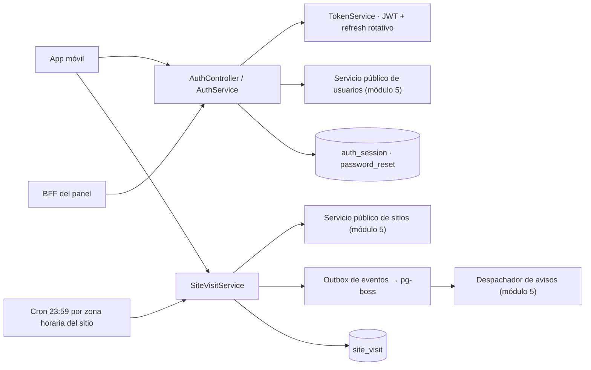

- **AuthService:** login, renovación de sesión, logout, recuperación de contraseña y aceptación de invitaciones. Es síncrono.
  - El login usa el rol estrecho de base de datos, porque busca por correo antes de conocer la organización.
- **TokenService:** firma los JWT, rota los refresh tokens y detecta su reutilización. Las llaves están en Secrets Manager.
- **SiteVisitService:** registra llegadas y salidas en línea o vía `sync/push`. Al registrar, publica `site_visit.arrived` o `site_visit.departed` al outbox; el aviso sale de forma asíncrona (#48).
  - Un cron cierra a las 23:59, hora del sitio, las estancias que siguen abiertas, con `auto_closed = true`.
  - Si después llega la salida real desde un teléfono que estaba sin conexión, reemplaza al cierre automático.
- **En el teléfono:**
  - Un store de sesión (Zustand) guarda el usuario y la estancia abierta (#8).
  - La lista de sitios se lee de SQLite (#5, #10).
  - La hora de llegada sale del reloj del teléfono y el servidor la ajusta (#6).
  - #11 (Could) calcula la distancia a las coordenadas del sitio en el teléfono, sin enviar la ubicación. Requiere agregar `lat/lng` a SITE cuando se active.

## Modelo de datos

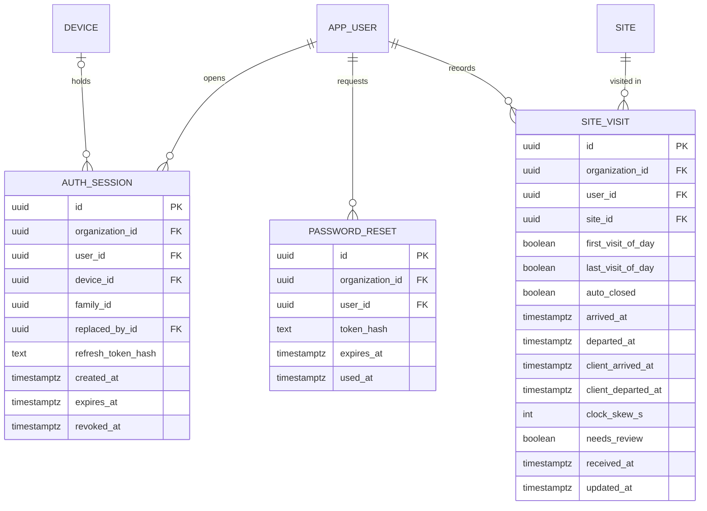

| Entidad | Propósito | Campos clave | Notas |
|---|---|---|---|
| AUTH_SESSION | Una sesión por dispositivo, con su refresh token rotativo | `family_id`, `refresh_token_hash`, `replaced_by_id`, `revoked_at` | Si se reutiliza un token ya rotado, se revoca toda la familia. Se purga 90 días después de revocada |
| PASSWORD_RESET | Token de recuperación de contraseña | `token_hash`, `expires_at` (30 min), `used_at` | Un solo uso. La solicitud siempre responde 202 |
| SITE_VISIT | La estancia de un técnico en un sitio | `arrived_at`, `departed_at`, `auto_closed`, `clock_skew_s`, `needs_review` | Único parcial: una estancia abierta por usuario. CHECK `departed_at >= arrived_at`. Es PII laboral y se retiene 24 meses |

## Contratos de API

| Método | Ruta | Propósito | Auth | Request | Response | Historia |
|---|---|---|---|---|---|---|
| POST | `/v1/auth/login` | Iniciar sesión | — | `{email, password, device:{id, platform, appVersion}}` | `200 {accessToken, refreshToken, expiresIn, user}` | #1, #2 |
| POST | `/v1/auth/refresh` | Rotar la sesión | refresh | `{refreshToken}` | `200 {accessToken, refreshToken, expiresIn}` · `401 SESSION_REVOKED` | #2 |
| POST | `/v1/auth/logout` | Cerrar la sesión del dispositivo | bearer | — | `204` | #2 |
| POST | `/v1/auth/password-reset` | Pedir enlace de recuperación | — | `{email}` | `202` siempre | #3 |
| POST | `/v1/auth/password-reset/confirm` | Fijar una contraseña nueva | — | `{token, newPassword}` | `204` · `400 TOKEN_INVALID` | #3 |
| POST | `/v1/auth/invitations/accept` | Activar la cuenta invitada | — | `{token, fullName, password}` | `200 {accessToken, refreshToken, user}` | #57 |
| GET | `/v1/me` | Perfil, rol y sitios asignados | bearer | — | `200 {user, sites[]}` | #5 |
| POST | `/v1/site-visits` | Registrar la llegada (idempotente por `id`) | bearer | `{id, siteId, clientArrivedAt, elapsedMs, firstVisitOfDay}` | `201 {siteVisit}` · `409 VISIT_ALREADY_OPEN` | #5, #6, #9 |
| POST | `/v1/site-visits/:id/depart` | Registrar la salida | bearer | `{clientDepartedAt, elapsedMs, lastVisitOfDay}` | `200 {siteVisit}` | #7, #9 |
| GET | `/v1/site-visits/open` | Estancia abierta del usuario | bearer | — | `200 {siteVisit \| null}` | #8 |

Sin conexión, la llegada y la salida viajan como mutaciones `site_visit.create` y `site_visit.depart` en `POST /v1/sync/push`, con el mismo payload.

**Formato de error (global):** `{ "error": { "code": "VISIT_ALREADY_OPEN", "message": "…", "details": {…}, "requestId": "…" } }`

## NFR específicos del módulo

| Categoría | Requisito | Meta | Respalda (PRD) |
|---|---|---|---|
| Rendimiento | Login, incluido argon2id | p95 < 800 ms | — |
| Seguridad | Revocar sesiones al desactivar a un usuario | ≤ 15 min, que es la vida máxima del JWT; el refresh se rechaza de inmediato | #58 |

## Observabilidad del módulo

| Evento | Cuándo se dispara | Propiedades | Equipo dueño |
|---|---|---|---|
| `auth_login_succeeded` / `auth_login_failed` | Al iniciar sesión | `platform`, `reason` (si falla) | Backend |
| `auth_refresh_reuse_detected` | Se reutilizó un refresh token ya rotado | `user_id`, `family_id` | Backend (dispara alerta de seguridad) |
| `site_visit_arrived` / `site_visit_departed` | Llegada o salida aplicada en el servidor | `site_type`, `offline` (bool), `clock_skew_s`, `duration_min` (en la salida), `first/last_visit`, `auto_closed` | Móvil y backend |

## Riesgos del módulo

| Riesgo | Probabilidad | Impacto | Mitigación |
|---|---|---|---|
| El técnico olvida marcar la salida y la estancia queda abierta días | Alta | Baja | Cierre automático a las 23:59 con `auto_closed`, visible en Informes. La salida real que llegue después lo reemplaza |
| Llegadas duplicadas por reintentos sin conexión | Media | Baja | Idempotencia por `id` y el único parcial de estancia abierta |

---

# Módulo 2: Mantenimiento preventivo

> Implementa PRD §Módulo 2 (historias #13–#28). Must: #13, #15–#20, #26. Should: #14, #21–#23, #27. Could: #24 (columnas pospuestas). Won't: #25, #28.

## Arquitectura

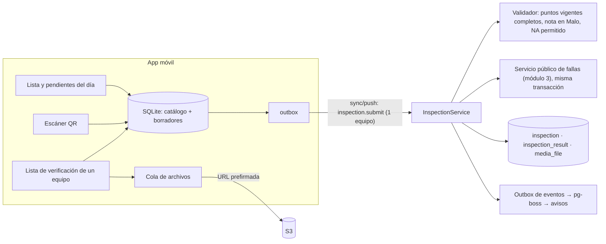

- **Una inspección es un equipo (#17, #19, #20):**
  - La inspección de un equipo vive en SQLite como borrador desde el primer toque. Cada punto marcado se escribe de inmediato, así que nada se pierde si la app se cierra a la fuerza.
  - Al terminar el equipo, con comentarios y firma, se encola **una** mutación `inspection.submit` con unos 15 resultados.
  - El supervisor ve el avance equipo por equipo, sin esperar a que termine el área.
  - Los borradores nunca se sincronizan; el servidor solo recibe inspecciones terminadas, que son inmutables.
- **Firma de la ronda (#22):** el técnico firma una vez y esa MEDIA_FILE se referencia en todas sus inspecciones de la misma área y el mismo día. Puede volver a firmar.
- **Hoja de área:** Informes reconstruye el formulario VOSOA agrupando por (area_id, local_date, inspector_id), en el orden `equipment.position`.
- **Encontrar el equipo:**
  - #13: lista por área e independientes, ordenada por `position`, desde SQLite.
  - #14: el QR codifica un enlace con `qr_token`; el escáner lo resuelve **sin conexión** buscándolo en SQLite. Si el token es de otro sitio, se muestra el error que describe el PRD.
- **InspectionService (servidor):**
  - Valida que estén respondidos todos los puntos de la plantilla **vigentes en `started_at`** (`deactivated_at` nulo o posterior). También acepta respuestas a puntos desactivados hasta 7 días antes.
  - Valida que cada `bad` tenga nota y que `na` solo aparezca donde el punto tiene `allows_na`.
  - Si algo falla, rechaza con `INSPECTION_INCOMPLETE`, `BAD_RESULT_NOTE_REQUIRED` o `NA_NOT_ALLOWED`.
  - Persiste la inspección e invoca a Correctivo en la misma transacción (#29). El constraint trigger diferido garantiza que todo `bad` tenga su hallazgo.
- **Pendientes del día (#26, #27):**
  - Se calculan en el teléfono: equipos del sitio vigentes ese día (`created_at` ≤ fin del día y `deactivated_at` nulo o posterior al inicio), menos los que ya tienen INSPECTION para la `local_date`.
  - Se ordenan por criticidad (A primero) y luego por `position`.
  - El servidor tiene el mismo cálculo para el panel.
- **Inspección anterior (#23):** el pull trae el último resultado por equipo de los sitios asignados.
- **Valor opcional (#24, Could):** pospuesto. Cuando se active se agregan `value`, `value_kind` y `value_unit` como columnas nulas.

## Modelo de datos

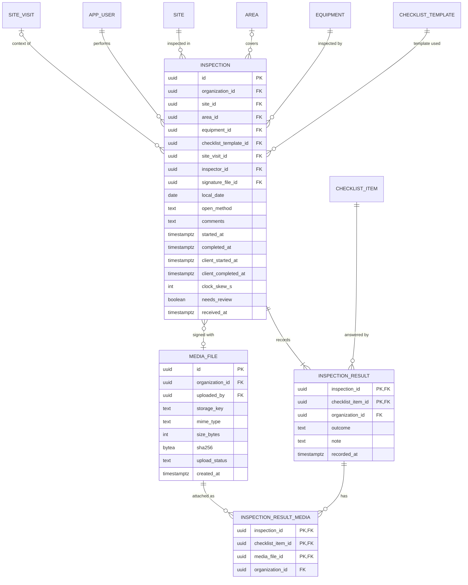

| Entidad | Propósito | Campos clave | Notas |
|---|---|---|---|
| INSPECTION | La inspección diaria de un equipo | `equipment_id`, `local_date`, `open_method`, `comments`, `signature_file_id`, `needs_review` | Inmutable. `area_id` es una foto del momento. FK compuesta (area_id, site_id). `site_visit_id ON DELETE SET NULL` |
| INSPECTION_RESULT | La respuesta a un punto | PK (inspection_id, checklist_item_id), `outcome` ∈ {good, bad, na}, `note` | Inmutable. CHECK de nota en `bad`. Es la tabla de mayor volumen (~70 M filas por año a 500 sitios) |
| MEDIA_FILE | Metadatos de un archivo en S3 | `storage_key`, `sha256` (bytea), `upload_status` ∈ {pending, uploaded, failed} | El teléfono crea la fila antes de subir. Un worker marca como `failed` las que siguen `pending` a los 30 días, sin borrarlas |
| INSPECTION_RESULT_MEDIA | Fotos de un hallazgo | PK (inspection_id, checklist_item_id, media_file_id) | Inmutable |

## Contratos de API

| Método | Ruta | Propósito | Auth | Request | Response | Historia |
|---|---|---|---|---|---|---|
| GET | `/v1/sync/pull` | Catálogo de los sitios asignados, fallas y último resultado por equipo | bearer | `?cursors={entity: "updated_at,id"}&limit=500` | `200 {changes:{sites, areas, equipment, checklistTemplates, checklistItems, userSites, lastResults, faults, faultEvents, faultFindings}, deletes:{…}, cursors, hasMore, serverNow}` · `410 CURSOR_EXPIRED` | #13, #23, #26, #34 |
| POST | `/v1/sync/push` | Enviar mutaciones de la cola | bearer | `{protocolVersion, clientNow, elapsedMs, mutations:[{mutationId, type, payload}]}` | `200 {results:[{mutationId, status, code?}], serverNow}` | #19 |
| — | mutación `inspection.submit` | Guardar la inspección de un equipo | — | `{id, equipmentId, templateId, siteVisitId?, openMethod, clientStartedAt, clientCompletedAt, elapsedMs, comments?, signatureMediaId?, results:[{checklistItemId, outcome, note?, mediaIds[]}]}` | `applied {localDate, faultIds[]}` · `rejected INSPECTION_INCOMPLETE \| BAD_RESULT_NOTE_REQUIRED \| NA_NOT_ALLOWED \| EQUIPMENT_NOT_IN_SITE \| ID_CONFLICT` | #15–#22, #29 |
| POST | `/v1/media` | Registrar un archivo y obtener la URL de subida | bearer | `{id, mimeType, sizeBytes, sha256}` | `201 {uploadUrl, expiresAt}` | #21, #22 |
| POST | `/v1/media/:id/complete` | Confirmar la subida | bearer | — | `204` · `409 CHECKSUM_MISMATCH` | #21, #22 |
| GET | `/v1/equipment/by-qr/:qrToken` | Resolver una etiqueta en línea (panel o respaldo) | bearer | — | `200 {equipment}` · `404` | #14 |
| GET | `/v1/sites/:siteId/inspections/today` | Pendientes y hechos de hoy | bearer | — | `200 {localDate, pending:[{equipmentId, criticality, position}], done:[…]}` | #26, #27 |
| GET | `/v1/inspections/:id` | Detalle de la inspección de un equipo | bearer | — | `200 {inspection, results[], media[]}` | #41 |
| GET | `/v1/inspection-sheets` | Hoja de área (formulario VOSOA reconstruido) | bearer | `?areaId=&localDate=&inspectorId=` | `200 {area, localDate, inspector, signature, inspections[]}` | #41 |

## NFR específicos del módulo

| Categoría | Requisito | Meta | Respalda (PRD) |
|---|---|---|---|
| Rendimiento | Persistir un punto marcado en SQLite | p95 < 50 ms | "Se siente inmediato" |
| Rendimiento | Escanear un QR y abrir la lista | p95 < 1.5 s con luz de interior | #14 |
| Almacenamiento | Fotos en el teléfono | ≤ 1600 px, unos 300 KB. Se borran 7 días después de confirmar la subida | — |

## Observabilidad del módulo

| Evento | Cuándo se dispara | Propiedades | Equipo dueño |
|---|---|---|---|
| `equipment_opened` | Se abre la lista de un equipo | `method` (scan/list), `criticality`, `equipment_type` | Móvil |
| `inspection_completed` | Inspección de un equipo aplicada en el servidor | `items_total`, `bad_count`, `na_count`, `duration_s`, `offline` (bool), `queued_age_s`, `has_signature`, `needs_review` | Backend |
| `inspection_rejected` | Mutación rechazada | `code`, `app_version` | Backend |
| `sync_batch_completed` | Lote de push o pull terminado | `mutations`, `rejected`, `max_queued_age_s`, `offline_duration_s` | Móvil |
| `qr_scan_failed` | Lectura fallida o etiqueta de otro sitio | `reason` | Móvil |

## Riesgos del módulo

| Riesgo | Probabilidad | Impacto | Mitigación |
|---|---|---|---|
| La plantilla cambia mientras un técnico tiene un borrador abierto | Media | Media | Se valida contra los puntos vigentes en `started_at`, con 7 días de gracia para los desactivados |
| Se abusa de "No aplica" para evitar revisar | Media | Media | Solo disponible donde el punto tiene `allows_na`. `na_count` visible en Informes |
| Etiqueta QR ilegible | Alta | Baja | Selección desde la lista siempre disponible (#13). Reimpresión (#55) |

---

# Módulo 3: Mantenimiento correctivo

> Implementa PRD §Módulo 3 (historias #29–#39). Must: #29–#31, #34, #35. Should: #32, #33, #36, #37. Could: #38 (columna pospuesta). Won't: #39.

## Arquitectura

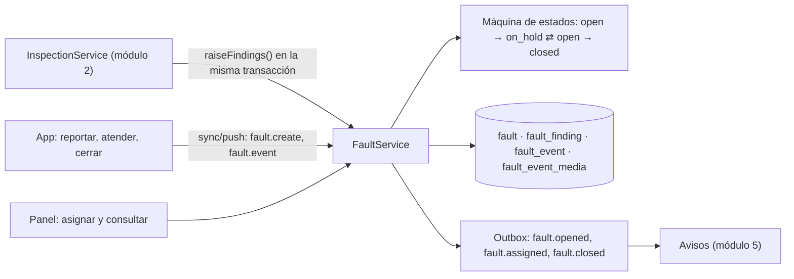

- **raiseFindings (#29, #32):** por cada resultado `bad`, hace un upsert sobre la falla abierta de (equipment_id, `lineage_id` del punto).
  - El `ON CONFLICT` repite el predicado del único parcial.
  - Si la falla ya existe, agrega un FAULT_FINDING y un evento `comment` con la nota.
  - Si no existe, crea una FAULT con `source=inspection`, `urgency=soon`, `criticality_at_open` copiada del equipo y `site_id`, más su FAULT_FINDING y el evento `reported`.
  - Como se agrupa por `lineage_id`, editar el texto de un punto no parte la agrupación.
- **Eventos (#34–#37):** todo cambio es un FAULT_EVENT que solo se agrega, con `client_occurred_at` y `clock_skew_s`. El estado y el responsable de FAULT se actualizan con *optimistic locking* (`version`) en la misma transacción.
  - Los CHECK de la base impiden estados incoherentes, como un cierre sin fecha o una espera sin motivo.
  - Un evento sobre una falla ya cerrada se guarda como comentario y devuelve el código `FAULT_ALREADY_CLOSED`.
- **Sin conexión (#31, #34):** el pull trae las fallas abiertas de los sitios asignados **con sus eventos y hallazgos**, así que el detalle y el historial se pueden consultar sin red.
- **Asignación (#37):** solo el rol `admin`, desde el panel o desde la app.
- **Repuestos (#38, Could):** pospuesto. Cuando se active se agrega `parts_used` como columna nula en FAULT_EVENT.

## Modelo de datos

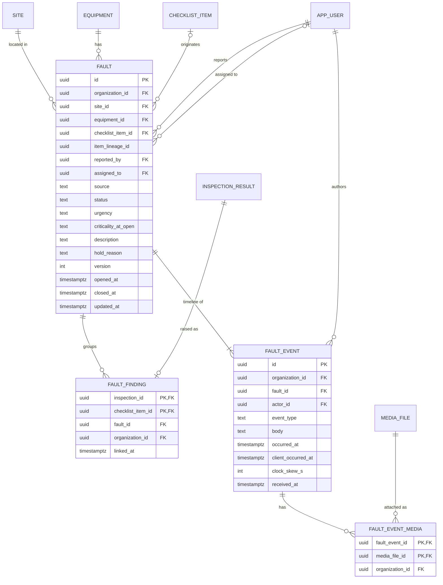

| Entidad | Propósito | Campos clave | Notas |
|---|---|---|---|
| FAULT | Un problema de un equipo con seguimiento | `status`, `urgency` ∈ {can_wait, soon, stopped}, `source` ∈ {inspection, manual}, `criticality_at_open`, `version` | Propiedad reactiva: `status`. Único parcial `(equipment_id, item_lineage_id) WHERE status IN ('open','on_hold')`. CHECK de cierre y de espera |
| FAULT_FINDING | Vincula cada hallazgo con su falla | PK (inspection_id, checklist_item_id) | Un hallazgo pertenece a una sola falla; una falla agrupa N hallazgos |
| FAULT_EVENT | Línea de tiempo | `event_type`, `body`, `client_occurred_at` | Inmutable. Es la fuente del historial (#34) |
| FAULT_EVENT_MEDIA | Evidencia en fotos | PK compuesta | — |

## Contratos de API

| Método | Ruta | Propósito | Auth | Request | Response | Historia |
|---|---|---|---|---|---|---|
| GET | `/v1/faults` | Fallas por sitio y estado, agrupadas por equipo | bearer | `?siteId=&status=open&sort=criticality,openedAt` | `200 {items:[{equipment, openCount, oldestOpenedAt, faults[]}]}` | #31, #42 |
| GET | `/v1/faults/:id` | Detalle con hallazgos, eventos y archivos | bearer | — | `200 {fault, findings[], events[], media[]}` | #34 |
| POST | `/v1/faults` | Reportar una falla manual (también la mutación `fault.create`) | bearer | `{id, equipmentId, description, urgency, clientOpenedAt, elapsedMs, mediaIds[]}` | `201 {fault}` · `422 DESCRIPTION_REQUIRED` | #30, #33 |
| POST | `/v1/faults/:id/events` | Comentar, actuar, poner en espera, reanudar, cerrar o asignar (también la mutación `fault.event`) | bearer (asignar: admin) | `{id, type, body?, holdReason?, assigneeId?, mediaIds[], expectedVersion, clientOccurredAt, elapsedMs}` | `201 {fault, event}` · `409 FAULT_ALREADY_CLOSED \| VERSION_CONFLICT` · `403` | #35–#37 |

## NFR específicos del módulo

| Categoría | Requisito | Meta | Respalda (PRD) |
|---|---|---|---|
| Consistencia | Hallazgos `bad` con FAULT_FINDING | 100 %, garantizado por un constraint trigger diferido y verificado por la conciliación nocturna | PRD §Métricas "Hallazgos → falla 100 %" |

## Observabilidad del módulo

| Evento | Cuándo se dispara | Propiedades | Equipo dueño |
|---|---|---|---|
| `fault_opened` | Se crea una falla | `source`, `criticality_at_open`, `urgency`, `equipment_type` | Backend |
| `fault_finding_grouped` | Un hallazgo se suma a una falla abierta | `open_age_h` | Backend |
| `fault_status_changed` | Cambio de estado | `from`, `to`, `age_h`, `criticality_at_open`, `has_media` | Backend |
| `fault_closed` | Cierre | `time_to_close_h`, `criticality_at_open`, `source`, `findings_count` | Backend |

## Riesgos del módulo

| Riesgo | Probabilidad | Impacto | Mitigación |
|---|---|---|---|
| Se agrupan hallazgos que en realidad son problemas distintos del mismo punto | Media | Baja | El administrador puede separar un hallazgo en una falla nueva (acción a evaluar en la Fase 2) |
| Un técnico cierra una falla sin conexión mientras el administrador la reasigna | Baja | Baja | Eventos que solo se agregan más `version`. Gana el cierre y la reasignación queda registrada como evento |

---

# Módulo 4: Informes

> Implementa PRD §Módulo 4 (historias #40–#47). Must: #40–#42, #45. Should: #43, #44, #46. Won't: #47.

## Arquitectura

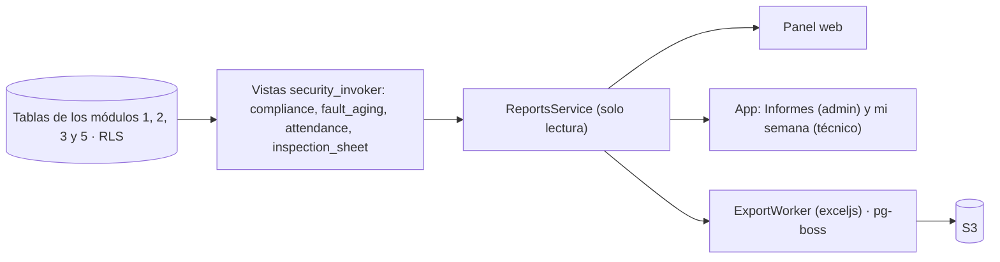

- **Piloto: consultas directas.** Los informes son vistas `security_invoker`, así que las RLS aplican con los permisos de quien consulta. Se apoyan en los índices de §Índices clave.
  - No hay vistas materializadas, porque ignoran las RLS y no se refrescan de forma incremental.
  - Los datos son **en tiempo real**, más la demora de sincronización, lo que cumple la meta del PRD de "< 1 hora".
- **Cumplimiento (#40):** "esperados" son los equipos vigentes en cada `local_date` (`created_at` y `deactivated_at`) en los días de operación de `organization.settings.operating_days`. "Hechos" son los que tienen INSPECTION ese día. Así el historial no cambia cuando se agregan o desactivan equipos.
- **Hoja de área (#41):** agrupa las inspecciones por (area_id, local_date, inspector_id) en el orden `equipment.position`, y reproduce el formulario VOSOA para auditoría.
- **Focos de hallazgos (#43):** usan el índice parcial de `bad`. Excluyen `na`.
- **"Mi semana" (#44):** consulta acotada al usuario. En la app se muestra con caché local.
- **Exportaciones (#46):** asíncronas. El resultado es un XLSX en S3 con enlace de 7 días.
- **Cuando haya muchas organizaciones:** si un informe supera su presupuesto, se introducen tablas de resumen con RLS (por ejemplo, cumplimiento diario por área) que un job de pg-boss actualiza de forma incremental.

## Modelo de datos

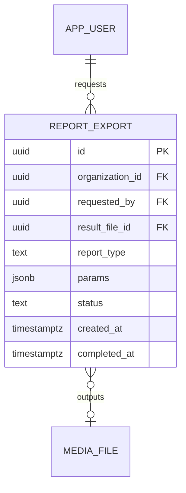

| Entidad | Propósito | Campos clave | Notas |
|---|---|---|---|
| REPORT_EXPORT | Solicitud y resultado de una exportación | `report_type` ∈ {inspections, faults, attendance}, `params`, `status` | Las vistas de informes son derivadas y no figuran como entidades del ERD |

## Contratos de API

| Método | Ruta | Propósito | Auth | Request | Response | Historia |
|---|---|---|---|---|---|---|
| GET | `/v1/reports/compliance` | Cumplimiento por sitio y área | admin | `?siteId=&from=&to=&groupBy=day\|week` | `200 {series:[{date, areaId, expected, done, pct}]}` | #40 |
| GET | `/v1/reports/faults/open` | Fallas abiertas por criticidad y antigüedad | admin | `?siteId=&criticality=` | `200 {buckets[], items[]}` | #42 |
| GET | `/v1/reports/faults/hotspots` | Equipos y puntos con más hallazgos | admin | `?from=&to=&limit=20` | `200 {equipment[], items[]}` | #43 |
| GET | `/v1/reports/attendance` | Asistencia | admin | `?siteId=&userId=&from=&to=` | `200 {visits:[{user, site, arrivedAt, departedAt, durationMin, autoClosed, needsReview}]}` | #45 |
| GET | `/v1/reports/me/weekly` | Resumen semanal del técnico | bearer | — | `200 {inspections, faultsReported, faultsClosed}` | #44 |
| POST | `/v1/reports/exports` | Pedir una exportación | admin | `{reportType, params}` | `202 {id}` | #46 |
| GET | `/v1/reports/exports/:id` | Estado y descarga | admin | — | `200 {status, downloadUrl?}` | #46 |

La hoja de área (#41) se expone en el módulo 2 (`/v1/inspection-sheets`).

## NFR específicos del módulo

| Categoría | Requisito | Meta | Respalda (PRD) |
|---|---|---|---|
| Rendimiento | Informes sobre rangos de 90 días | p95 < 2 s | "En menos de un minuto el supervisor sabe qué falta" |
| Frescura | Retraso de los informes | Tiempo real, más la demora de sincronización | PRD §Métricas "< 1 hora" |
| Rendimiento | Exportación de 12 meses de un sitio | < 60 s | #46 |

## Observabilidad del módulo

| Evento | Cuándo se dispara | Propiedades | Equipo dueño |
|---|---|---|---|
| `report_viewed` | Se abre un informe | `report`, `surface` (web/app), `range_days`, `duration_ms` | Web y móvil |
| `export_completed` | Termina una exportación | `report_type`, `rows`, `duration_s` | Backend |

## Riesgos del módulo

| Riesgo | Probabilidad | Impacto | Mitigación |
|---|---|---|---|
| Las consultas directas se vuelven lentas al crecer | Media | Media | Alarma si el p95 de un informe supera 2 s. Pasar a tablas de resumen con RLS actualizadas por pg-boss |
| Un informe muestra datos incompletos por envíos pendientes en los teléfonos | Media | Baja | Indicador "pueden faltar datos" basado en `DEVICE.last_seen_at` y la última sincronización |

---

# Módulo 5: Administración

> Implementa PRD §Módulo 5 (historias #48–#59). Must: #48, #49, #52–#54, #57, #58. Should: #50, #51, #55, #56. Won't: #59.

## Arquitectura

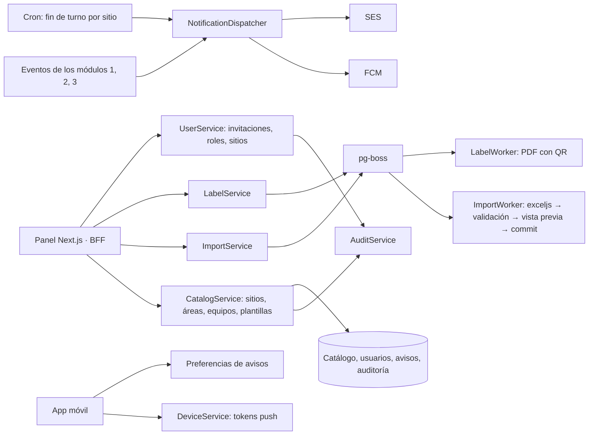

- **CatalogService (#52, #53, #56):**
  - No hay borrado físico: "eliminar" pone `deactivated_at` y el registro queda en el historial.
  - Editar el texto o el "No aplica" de un punto crea un CHECKLIST_ITEM nuevo con el mismo `lineage_id` y desactiva el anterior.
  - Mover un equipo de sitio actualiza `site_id`. El pull les indica a los teléfonos que ya no lo deben ver que lo borren de su base local.
- **ImportService (#54):** se sube el XLSX y se crea un IMPORT_JOB. El worker valida contra la plantilla canónica:
  - hojas Sitios, Áreas, Equipos, Plantillas y Puntos;
  - etiquetas y números de activo únicos;
  - puntos con texto;
  - criticidad válida;
  - marca de "si aplica" para `allows_na`.
  - El resultado es un `validation_report` y una vista previa.
  - El `commit` es **una sola transacción** sin escrituras parciales, e idempotente por llaves naturales: `tag` en equipos, `(organization_id, name)` en plantillas y `(template, label)` en puntos vigentes. Reimportar actualiza en lugar de duplicar.
  - El protocolo de pull tolera la transacción larga gracias a `clock_timestamp()` y al traslape de 2 minutos.
- **LabelService (#55):** genera un PDF con un QR por equipo. El QR codifica un enlace universal con `qr_token`, que es único global, acompañado de la etiqueta y el nombre legibles.
- **UserService (#57, #58):**
  - Invitaciones por correo con token de un solo uso.
  - Asignación de sitios en USER_SITE con borrado lógico, para que la revocación llegue al teléfono.
  - Desactivación con revocación inmediata de sesiones (módulo 1).
- **NotificationDispatcher:**
  - #48: llegadas y salidas.
  - #49: fallas o hallazgos de criticidad A; van por push **y** correo.
  - #51: cron al fin de turno según `timezone` del sitio y `settings.shift_end`.
  - Respeta NOTIFICATION_PREFERENCE (#50), guarda cada envío en NOTIFICATION y deduplica por (usuario, evento, entidad) en 10 minutos.
- **AuditService:** registra los cambios de catálogo, usuarios y permisos en AUDIT_EVENT, sin secretos, hashes ni tokens en el `diff`.

## Modelo de datos

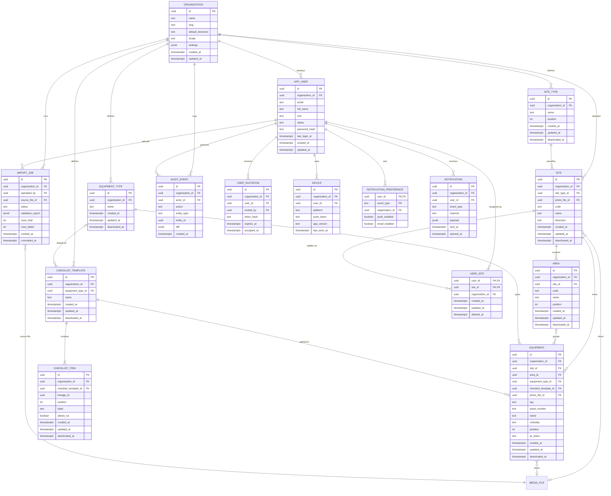

| Entidad | Propósito | Campos clave | Notas |
|---|---|---|---|
| ORGANIZATION | Empresa (tenant) | `slug`, `default_timezone`, `settings` | `settings` incluye flags, `min_app_version`, `shift_end` y `operating_days` |
| APP_USER | Persona usuaria | `email` (único global), `role`, `status` | PII. "user" es palabra reservada en Postgres; por eso se llama `app_user` |
| USER_INVITATION | Invitación pendiente | `token_hash`, `expires_at` | 7 días, un solo uso |
| USER_SITE | Sitios que ve cada usuario | PK compuesta, `deleted_at` | Los administradores ven todos los sitios de su organización sin necesidad de filas |
| SITE_TYPE | Tipos configurables | `name`, `position` | Semilla para Holcim: Fijo, Mini, Móvil, Planta |
| SITE | Lugar físico | `code`, `timezone` | Único `(organization_id, code)` |
| AREA | Agrupación dentro de un sitio | `code` (p. ej. "311") | Semilla para Tepeagua: Trituradora Primaria, Secundaria y Terciaria. `UNIQUE (id, site_id)` para la FK compuesta |
| EQUIPMENT_TYPE | Clase de equipo | `name` | Semilla: banda, criba, trituradora, alimentador vibratorio, tolva |
| EQUIPMENT | Activo inspeccionable | `tag`, `asset_number`, `criticality`, `position`, `qr_token` | Sin `area_id` = independiente. FK compuesta (area_id, site_id) |
| CHECKLIST_TEMPLATE | Lista reutilizable | `name` | Única por (organización, nombre) |
| CHECKLIST_ITEM | Punto de revisión | `lineage_id`, `position`, `label`, `allows_na` | Inmutable salvo `position` y `deactivated_at` |
| IMPORT_JOB | Carga desde Excel | `status` ∈ {uploaded, validating, invalid, ready, committed, failed}, `validation_report` | Se purga a los 90 días |
| DEVICE | Teléfono del usuario | `push_token`, `app_version`, `last_seen_at` | `last_seen_at` alimenta el indicador "pueden faltar datos" |
| NOTIFICATION_PREFERENCE | Qué avisos recibe un usuario | PK (user_id, event_type) | Valores por defecto según el rol |
| NOTIFICATION | Bitácora de envíos | `channel`, `sent_at`, `opened_at` | Responde la pregunta de analítica 8 |
| AUDIT_EVENT | Auditoría de administración | `action`, `entity_type`, `diff` | Solo agrega. Retención de 24 meses |

## Contratos de API

| Método | Ruta | Propósito | Auth | Request | Response | Historia |
|---|---|---|---|---|---|---|
| GET/POST/PATCH | `/v1/admin/site-types`, `/v1/admin/sites`, `/v1/admin/areas`, `/v1/admin/equipment-types` | Catálogo | admin | JSON de la entidad | `200/201 {entity}` · `409 DUPLICATE_CODE` | #52 |
| GET/POST/PATCH | `/v1/admin/equipment` | Equipos | admin | `{siteId, areaId?, equipmentTypeId, checklistTemplateId, tag, assetNumber?, name, criticality, position, photoMediaId?}` | `201 {equipment}` · `409 DUPLICATE_TAG` | #52 |
| GET/POST/PATCH | `/v1/admin/checklist-templates`, `/v1/admin/checklist-templates/:id/items` | Plantillas y puntos | admin | `{name, equipmentTypeId?, items:[{label, position, allowsNa}]}` | `201 {template}` | #53, #56 |
| POST | `/v1/admin/{entity}/:id/deactivate` | Desactivar sin perder historial (no existe DELETE) | admin | — | `200 {entity}` | #56 |
| POST | `/v1/admin/imports` | Subir Excel | admin | multipart `file` | `202 {id}` | #54 |
| GET | `/v1/admin/imports/:id` | Estado, errores y vista previa | admin | — | `200 {status, report:{errors:[{sheet,row,field,code}]}, preview}` | #54 |
| POST | `/v1/admin/imports/:id/commit` | Confirmar la carga | admin | — | `200 {created, updated}` · `409 IMPORT_NOT_READY` | #54 |
| POST | `/v1/admin/labels` | PDF de etiquetas | admin | `{equipmentIds[] \| siteId, format}` | `200 application/pdf` | #55 |
| GET/POST/PATCH | `/v1/admin/users` | Invitar y editar usuarios | admin | `{email, fullName, role}` | `201 {user}` · `409 EMAIL_TAKEN` | #57 |
| PUT | `/v1/admin/users/:id/sites` | Asignar sitios | admin | `{siteIds[]}` | `200` | #57 |
| POST | `/v1/admin/users/:id/disable` | Desactivar y revocar sesiones | admin | — | `200` | #58 |
| POST | `/v1/devices` | Registrar el token push | bearer | `{id, platform, pushToken, appVersion}` | `204` | #48, #49 |
| GET/PUT | `/v1/me/notification-preferences` | Preferencias de avisos | bearer | `{items:[{eventType, push, email}]}` | `200` | #50 |
| GET | `/v1/me/notifications` | Bandeja de avisos | bearer | `?cursor=` | `200 {items[], nextCursor}` | #48, #49 |

## NFR específicos del módulo

| Categoría | Requisito | Meta | Respalda (PRD) |
|---|---|---|---|
| Rendimiento | Validar un Excel de 500 equipos y 5 000 puntos | < 60 s | #54 |
| Latencia | Aviso de criticidad A desde que llega al servidor | p95 < 60 s por push; < 2 min por correo | #49 |
| Etiquetas | QR legible | ≥ 2 cm de lado, con corrección de errores nivel Q | #55 |

## Observabilidad del módulo

| Evento | Cuándo se dispara | Propiedades | Equipo dueño |
|---|---|---|---|
| `import_validated` / `import_committed` | En cada etapa de la importación | `rows_total`, `rows_failed`, `duration_s` | Backend |
| `notification_sent` / `notification_opened` | Envío y apertura de un aviso | `event_type`, `channel`, `latency_s` | Backend y móvil |
| `user_invited` / `user_activated` / `user_disabled` | Ciclo de vida del usuario | `role` | Backend |
| `labels_generated` | Se genera un PDF de etiquetas | `count`, `format` | Backend |

## Riesgos del módulo

| Riesgo | Probabilidad | Impacto | Mitigación |
|---|---|---|---|
| La plantilla canónica de Excel no coincide con los Excel reales de VOSOA | Alta | Media | Diseñarla a partir de los originales (T1). El mapeo de columnas por cliente queda fuera de v1 |
| Un cambio masivo de catálogo genera un pull pesado en todos los teléfonos | Baja | Media | Pull paginado de 500 filas y compresión gzip. El catálogo de un sitio grande pesa menos de 1 MB |
| Avisos duplicados por reintentos del outbox | Media | Baja | Deduplicación por (usuario, evento, entidad) en 10 minutos |
| No está definido cómo se da de baja a una empresa completa | Baja | Media | Definir el proceso de exportación y borrado de un tenant antes de la Fase 4 |

---

## Historial de cambios

| Fecha | Autor | Cambios |
|---|---|---|
| 2026-11-16 | Didier Cruz (con Claude) | Borrador inicial a partir de PRD.md v1, los formularios VOSOA y las decisiones del PO (NestJS con auth propia, SQLite local con op-sqlite + Drizzle, panel web y app, repos separados) |
| 2026-11-16 | Didier Cruz (con Claude) | Revisión de DBA aplicada: inspección por equipo (se elimina INSPECTION_EQUIPMENT); PK natural en resultados; `organization_id` y FK compuestas en todas las tablas; RLS forzada; cursor por entidad con `clock_timestamp()` y traslape; "No aplica"; linaje de puntos; borrado lógico en todo el catálogo; CHECK y triggers de integridad; índices; sin vistas materializadas; recortes para el piloto |
